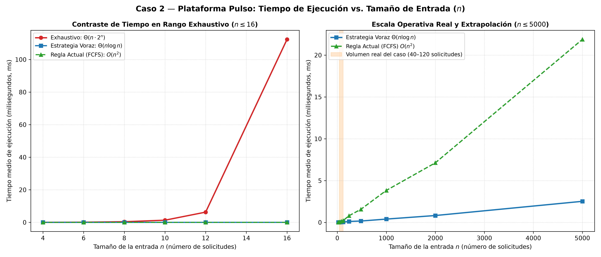
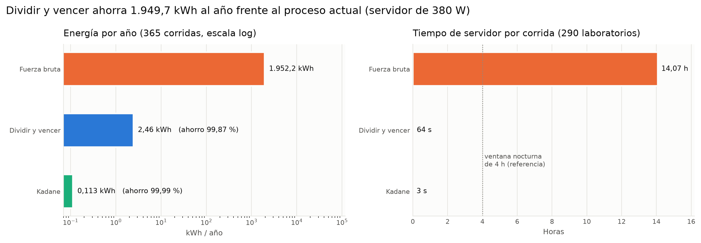

# Informe Técnico — Plataforma Pulso: Análisis de Algoritmos Aplicado al Tamizaje de Diabetes

| Campo | Detalle |
|---|---|
| **Asignatura** | Análisis de Algoritmos — Modalidad Asíncrona |
| **Institución** | Instituto Tecnológico Metropolitano (ITM) — Semestre Académico 2026-2 |
| **Grupo y Caso** | Grupo 8 — Caso 2: Plataforma Pulso (Tamizaje masivo de diabetes mellitus tipo 2) |
| **Operaciones Desarrolladas** | Operación 3 (Jornadas de unidades móviles) · Operación 4 (Vigilancia analítica de laboratorios) |

**Integrantes del equipo de trabajo:**

| Nombre Completo | Rol Asignado |
|---|---|
| Juan Felipe Patiño Calderón | Persona 1 — Análisis del Problema y Modelado Formal |
| Januar Stiwar Martinez Palacios | Persona 2 — Diseño Algorítmico e Implementación |
| Juan Felipe Torres Torres | Persona 3 — Evaluación Empírica y Experimentación |
| Santiago Villada Arboleda | Persona 4 — Formalización Teórica, Integración y Documentación |

---

## Tabla de Contenido

1. [Análisis del problema](#1-análisis-del-problema)
   - 1.1 [Contexto institucional, epidemiológico y descripción computacional](#11-contexto-institucional-epidemiológico-y-descripción-computacional)
   - 1.2 [Identificación de las operaciones críticas del proceso](#12-identificación-de-las-operaciones-críticas-del-proceso)
   - 1.3 [Costo energético del proceso actual (línea base)](#13-costo-energético-del-proceso-actual-línea-base)
   - 1.4 [Formalización de la Operación 3: Programación de unidades móviles](#14-formalización-de-la-operación-3-programación-de-unidades-móviles)
   - 1.5 [Formalización de la Operación 4: Vigilancia de calidad de laboratorios](#15-formalización-de-la-operación-4-vigilancia-de-calidad-de-laboratorios)
2. [Diseño de la solución](#2-diseño-de-la-solución)
   - 2.1 [Estructuras de datos seleccionadas](#21-estructuras-de-datos-seleccionadas)
   - 2.2 [Diseño algorítmico de la Operación 3 (Estrategia Voraz)](#22-diseño-algorítmico-de-la-operación-3-estrategia-voraz)
   - 2.3 [Diseño algorítmico de la Operación 4 (Dividir y Vencer)](#23-diseño-algorítmico-de-la-operación-4-dividir-y-vencer)
3. [Implementación](#3-implementación)
   - 3.1 [Arquitectura modular y tecnologías utilizadas](#31-arquitectura-modular-y-tecnologías-utilizadas)
   - 3.2 [Decisiones técnicas de implementación y mitigación de errores](#32-decisiones-técnicas-de-implementación-y-mitigación-de-errores)
   - 3.3 [Protocolo de verificación y pruebas automatizadas](#33-protocolo-de-verificación-y-pruebas-automatizadas)
4. [Evaluación del desempeño](#4-evaluación-del-desempeño)
   - 4.1 [Análisis formal de complejidad temporal y espacial](#41-análisis-formal-de-complejidad-temporal-y-espacial)
   - 4.2 [Deducción formal de recurrencia y Teorema Maestro](#42-deducción-formal-de-recurrencia-y-teorema-maestro)
   - 4.3 [Metodología de medición y entorno experimental](#43-metodología-de-medición-y-entorno-experimental)
   - 4.4 [Resultados experimentales y figuras técnicas](#44-resultados-experimentales-y-figuras-técnicas)
   - 4.5 [Contraste empírico vs. teórico, factores de escala y validación real ($n=33.000$)](#45-contraste-empírico-vs-teórico-factores-de-escala-y-validación-real-n33000)
   - 4.6 [Verificación de restricciones de negocio y extrapolación operativa](#46-verificación-de-restricciones-de-negocio-y-extrapolación-operativa)
5. [Análisis comparativo](#5-análisis-comparativo)
   - 5.1 [Comparativa técnica de la Operación 3](#51-comparativa-técnica-de-la-operación-3)
   - 5.2 [Demostración formal del contraejemplo contra la regla actual FCFS](#52-demostración-formal-del-contraejemplo-contra-la-regla-actual-fcfs)
   - 5.3 [Condición contraria: cuándo aplicar Programación Dinámica](#53-condición-contraria-cuándo-aplicar-programación-dinámica)
   - 5.4 [Comparativa técnica de la Operación 4](#54-comparativa-técnica-de-la-operación-4)
6. [Implicaciones éticas, sociales y ambientales](#6-implicaciones-éticas-sociales-y-ambientales)
   - 6.1 [Preguntas de impacto ético y bioética en salud pública](#61-preguntas-de-impacto-ético-y-bioética-en-salud-pública)
   - 6.2 [Consecuencias humanas de los errores algorítmicos y mitigaciones](#62-consecuencias-humanas-de-los-errores-algorítmicos-y-mitigaciones)
   - 6.3 [Consumo energético consolidado y proyección anual](#63-consumo-energético-consolidado-y-proyección-anual)
   - 6.4 [Marco normativo colombiano y protección de datos clínicos](#64-marco-normativo-colombiano-y-protección-de-datos-clínicos)
   - 6.5 [Sostenibilidad y sensibilidad ante crecimiento futuro ($2\times$ datos)](#65-sostenibilidad-y-sensibilidad-ante-crecimiento-futuro-2times-datos)
7. [Conclusiones y recomendaciones](#7-conclusiones-y-recomendaciones)
8. [Referencias normativas y bibliográficas](#8-referencias-normativas-y-bibliográficas)
- [Anexo: Instrucciones de reproducción del entorno y experimentos](#anexo-instrucciones-de-reproducción-del-entorno-y-experimentos)

---

## 1. Análisis del problema

### 1.1 Contexto institucional, epidemiológico y descripción computacional

La diabetes mellitus tipo 2 constituye una de las principales amenazas de salud pública a nivel global y nacional. En Colombia, el Ministerio de Salud y Protección Social estima que cerca del 8% al 10% de la población adulta padece diabetes, de los cuales más de un tercio desconoce su diagnóstico. La progresión asintomática de la hiperglucemia crónica desencadena complicaciones crónicas irreversibles de alto costo humano y financiero: nefropatía diabética (principal causa de ingreso a hemodiálisis), retinopatía proliferativa con ceguera permanente, neuropatía periférica causante de amputaciones no traumáticas de miembros inferiores, e infartos agudos de miocardio.

La intervención más costo-efectiva en salud poblacional radica en el tamizaje sistemático mediante el instrumento validado FINDRISC (*Finnish Diabetes Risk Score*), que permite identificar cohortes en riesgo moderado y alto (puntaje $\ge 70$) antes de que debute la sintomatología clínica. Para materializar esta estrategia en un departamento caracterizado por una compleja orografía andina, alta dispersión rural y dificultades de acceso vial, la Secretaría de Salud financia el desarrollo de la **Plataforma Pulso**.

La Plataforma Pulso centraliza el procesamiento de datos epidemiológicos provenientes de **9 subregiones departamentales** e integra la información generada por **290 laboratorios clínicos e Instituciones Prestadoras de Salud (IPS)** habilitadas en el territorio.

Desde la perspectiva de la infraestructura tecnológica, la plataforma opera en un **servidor corporativo institucional** bajo una potencia nominal sostenida de **380 W (0,380 kW)**. Las políticas de gobernanza de TI de la Secretaría restringen el procesamiento masivo por lotes a una **ventana operativa nocturna estricta de 4 horas (14.400 segundos)**, comprendida diariamente entre la 01:00 y las 05:00 horas. Al término de esta ventana, las agendas asistenciales y los tableros de control epidemiológico deben estar consolidados para la toma de decisiones de las direcciones seccionales de salud.

La plataforma enfrenta dos cuellos de botella algorítmicos críticos:
1. **Programación de unidades móviles (Operación 3):** Cada una de las 9 subregiones dispone de una única unidad móvil equipada para valoración médica y paraclínica en territorio. Dado que la unidad no puede bifurcarse para atender dos municipios simultáneamente ni puede fragmentar su estadía, el desafío consiste en seleccionar el conjunto de solicitudes municipales que maximice la presencia territorial sin ocasionar colisiones temporales.
2. **Vigilancia de calidad de laboratorios (Operación 4):** Con 290 sedes procesando ~30 lotes diarios, cada laboratorio acumula aproximadamente 33.000 lotes en un histórico de 3 años. El desajuste de un fotómetro o el deterioro de un reactivo de laboratorio puede inducir un sesgo analítico continuado durante semanas, emitiendo diagnósticos falsos. El reto computacional exige examinar la serie cronológica completa para aislar el intervalo continuo con mayor exceso de anomalías.

---

### 1.2 Identificación de las operaciones críticas del proceso

El flujo computacional completo de la Plataforma Pulso comprende cuatro operaciones secuenciales:

| Operación | Nombre Operativo | Responsabilidad Técnica | Estado Computacional |
|---|---|---|---|
| **Op. 1** | Consolidación y desduplicación | Fusión cronológica y depuración de pruebas redundantes | Resuelta en fase preliminar |
| **Op. 2** | Priorización clínica | Ordenamiento por puntaje FINDRISC de pacientes | Resuelta en fase preliminar |
| **Op. 3** | **Programación de unidades móviles** | **Selección de jornadas municipales compatibles para maximizar visitas** | **Crítica: regla actual FCFS pierde hasta 200% de cobertura** |
| **Op. 4** | **Vigilancia de calidad analítica** | **Identificación del intervalo histórico de máxima descalibración analítica** | **Crítica: fuerza bruta $\Theta(n^2)$ tarda más de 14 horas de cómputo** |

Este informe se concentra en la formalización matemática, diseño algorítmico, implementación óptima y evaluación experimental de las **Operaciones 3 y 4**, responsables del agotamiento de la ventana operativa nocturna y del sobrecosto energético en el servidor.

---

### 1.3 Costo energético del proceso actual (línea base)

El cálculo del costo eléctrico en sistemas de cómputo continuo se rige por la relación física entre potencia demandada y tiempo de ejecución:

$$\text{Energía (kWh)} = \text{Potencia (kW)} \times \text{Tiempo (horas)} = 0{,}380\,\text{kW} \times \frac{t\,(\text{s})}{3600}$$

La línea base operativa registrada históricamente en la Secretaría evidencia el agotamiento de la infraestructura:

| Operación | Algoritmo Histórico | Carga Operativa | Tiempo de Cómputo | Consumo por Corrida | Frecuencia | Consumo Eléctrico Anual |
|---|---|---|---:|---:|---|---:|
| **Op. 3** | FCFS (orden de llegada) | 9 subregiones ($n = 120$ sol/mes) | 0,001435 s | $1{,}52 \times 10^{-7}\text{ kWh}$ | Mensual (12) | $1{,}82 \times 10^{-6}\text{ kWh}$ |
| **Op. 4** | Fuerza bruta cuadrática $\Theta(n^2)$ | 290 laboratorios ($n = 33.000$ lotes) | 50.663 s (**14,07 h**) | $5{,}348\text{ kWh}$ | Diaria (365) | **1.952,16 kWh/año** |
| **Total Línea Base** | **Infraestructura no optimizada** | — | — | **5,348 kWh** | — | **1.952,16 kWh/año** |

*Diagnóstico de la línea base:*
- La Operación 4 desborda la ventana de 4 horas en un **251,7%** (tarda más de 14 horas continuas), haciendo físicamente imposible ejecutar la vigilancia analítica a diario. La Secretaría se ve forzada a espaciar las auditorías a esquemas mensuales o trimestrales, permitiendo que equipos descalibrados emitan miles de diagnósticos falsos antes de ser detectados.
- La Operación 3, aunque rápida en CPU, exhibe un alto costo social: al asignar por turno de llegada, jornadas extensas bloquean franjas horarias completas donde podrían haberse realizado múltiples jornadas en municipios vecinos.

---

### 1.4 Formalización de la Operación 3: Programación de jornadas de unidades móviles

#### Definición formal de entradas
Sea $S = \{s_1, s_2, \ldots, s_n\}$ el conjunto de solicitudes de jornadas de valoración médica remitidas por los municipios de una subregión durante el mes. Cada solicitud individual $s_i$ se modela formalmente como una 3-tupla:

$$s_i = (\text{inicio}_i,\ \text{fin}_i,\ \text{pacientes}_i) \in \mathbb{Z}_{\ge 0} \times \mathbb{Z}_{>0} \times \mathbb{Z}_{\ge 0}$$

donde:
- $\text{inicio}_i$: Minuto del mes en que inicia la jornada (minuto 0 = día 1 a las 00:00 h).
- $\text{fin}_i$: Minuto en que concluye la jornada, **incorporando estrictamente el tiempo de traslado terrestre** de la unidad móvil hasta la siguiente cabecera municipal.
- $\text{pacientes}_i$: Número de personas en riesgo alto (FINDRISC $\ge 70$) censadas en ese municipio.

#### Definición formal de salidas
Un subconjunto compatible $S^* \subseteq S$ que maximiza la cantidad total de jornadas agendadas:

$$S^* = \arg\max_{A \subseteq S,\ \text{compatible}} |A|$$

entregado estrictamente ordenado por hora cronológica de inicio: $\text{inicio}_j \le \text{inicio}_{j+1}$ para todo $j \in \{1, \ldots, |S^*|-1\}$.

#### Restricciones de negocio
- **R3.1 — Exclusividad física:** La unidad móvil no puede atender dos jornadas simultáneas ni solapar desplazamientos. Dos solicitudes $s_i, s_j$ se cruzan si:
  $$\max(\text{inicio}_i, \text{inicio}_j) < \min(\text{fin}_i, \text{fin}_j)$$
- **R3.2 — Indivisibilidad horaria:** Una jornada aceptada debe ejecutarse íntegramente en $[\text{inicio}_i, \text{fin}_i)$; no se admiten fraccionamientos ni recortes de horario.
- **R3.3 — Intervalos semiabiertos:** $[\text{inicio}, \text{fin})$. Si una jornada termina exactamente en el minuto $M$ y la siguiente inicia en el minuto $M$, **no existe cruce**, dado que el traslado vehicular está incorporado en $\text{fin}$.
- **R3.4 — Independencia subregional:** Las 9 subregiones cuentan con vehículos disyuntos; sus 9 problemas de agendamiento son matemáticamente independientes.

#### Supuestos adoptados por el equipo
1. **Horizonte temporal acotado:** Mes de 43.200 minutos (30 días), si bien los algoritmos son independientes de la duración del mes.
2. **Validación estricta:** Tuplas con $\text{inicio} \ge \text{fin}$ o valores negativos generan un error controlado de tipo `ValueError`.
3. **Criterio de desempate social:** A igual hora de finalización, se prioriza la jornada con mayor número de pacientes; si persiste el empate, la de inicio más temprano.

---

### 1.5 Formalización de la Operación 4: Vigilancia de calidad de laboratorios

#### Modelado analítico y entradas formales
Cada laboratorio clínico remite sus registros agrupados en lotes (~30 lotes diarios). Para cada lote $i$, se define el **exceso de positividad** $x_i$ como:

$$x_i = \text{tasa\_observada}_i - \text{tasa\_esperada}_i \in [-1{,}0,\ 1{,}0] \subset \mathbb{R}$$

Bajo calibración óptima, $x_i$ fluctúa alrededor de cero. Si un analizador sufre descalibración fotométrica, genera un incremento positivo sostenido en la tasa observada. La entrada se define como la serie cronológica inmutable de $n$ lotes históricos ($n \approx 33.000$ en 3 años):

$$X = \langle x_0, x_1, \ldots, x_{n-1} \rangle, \quad x_i \in \mathbb{R}$$

#### Definición formal de salidas
El par de índices $(l^*, r^*)$ que delimita el tramo continuo con mayor exceso acumulado (Problema del Subarreglo de Suma Máxima):

$$(l^*, r^*) = \arg\max_{0 \le l \le r < n} \sum_{k=l}^{r} x_k, \quad \text{con valor acumulado } M^* = \sum_{k=l^*}^{r^*} x_k$$

#### Restricciones de negocio
- **R4.1 — Inmutabilidad y trazabilidad legal:** La información histórica no puede ser modificada en memoria durante el procesamiento.
- **R4.2 — Exactitud matemática certificada:** Equivalencia absoluta con la referencia exhaustiva (tolerancia $< 10^{-4}$).
- **R4.3 — Periodicidad diaria mandatoria:** Ejecución obligatoria cada 24 horas para los 290 laboratorios.
- **R4.4 — Restricción de ventana nocturna:** Tiempo total menor a los 14.400 segundos disponibles.

---

## 2. Diseño de la solución

### 2.1 Estructuras de datos seleccionadas

Para maximizar el rendimiento y asegurar inmutabilidad, se prescindió de objetos pesados con diccionarios dinámicos (`__dict__`), empleando estructuras nativas de memoria contigua:
- **Operación 3:** Se utiliza la tupla inmutable nativa de Python `Jornada = tuple[int, int, int]`, que ocupa memoria contigua, ofrece sobrecarga cero de asignación y permite ordenamiento en C vía Timsort.
- **Operación 4:** Se implementan `NamedTuple` del módulo `typing`:
  - `Lote`: encapsula `id_lote`, `id_laboratorio`, `fecha_resultado`, `tasa_observada`, `tasa_esperada` y `exceso`.
  - `ResultadoTramo`: encapsula `indice_inicio`, `indice_fin` y `exceso_acumulado`.
  Garantizan inmutabilidad absoluta y ocupan únicamente 8 bytes por referencia en arquitectura de 64 bits.

---

### 2.2 Diseño algorítmico de la Operación 3 (Estrategia Voraz)

Se contrastan tres estrategias:
1. **Algoritmo Voraz (EFT — Earliest Finish Time):** Ordena las solicitudes por hora de finalización ascendente `(fin ASC, -pacientes, inicio ASC)` y selecciona secuencialmente cada jornada que no presente cruce con la última aceptada.
   - *Lema de intercambio (Optimalidad):* Sea $j_1$ la actividad con menor fin en $S$ y $O = \{o_1, \ldots, o_k\}$ una solución óptima ordenada. Si $o_1 \neq j_1$, por definición $\text{fin}(j_1) \le \text{fin}(o_1)$. Como las jornadas de $O$ son mutuamente compatibles, se cumple que $\text{inicio}(o_2) \ge \text{fin}(o_1) \ge \text{fin}(j_1)$. Por ende, $j_1$ es plenamente compatible con $\{o_2, \ldots, o_k\}$. Construyendo $O' = (O \setminus \{o_1\}) \cup \{j_1\}$, obtenemos una solución compatible de igual tamaño $|O'| = |O| = k$. Por inducción matemática, elegir en cada paso la que finaliza antes conduce al óptimo global.
   - *Subestructura óptima:* Tras seleccionar $j_1$, el problema restante sobre $S' = \{s \in S \mid \text{inicio}(s) \ge \text{fin}(j_1)\}$ conserva la misma estructura matemática que el problema original.
2. **Solución Exhaustiva Combinatoria ($2^n$):** Evalúa todos los $2^n - 1$ subconjuntos posibles verificando compatibilidad horaria con `hay_cruce()`. Su costo es $\Theta(n \cdot 2^n)$; sirve de oráculo formal para $n \le 22$.
3. **Regla Actual (FCFS):** Recorre las solicitudes en el estricto orden de llegada municipal. Acepta si no solapa con las ya agendadas; de lo contrario descarta. Complejidad $\Theta(n^2)$, subóptima y con bloqueo prematuro de agenda.

#### Pseudocódigo formal del algoritmo voraz

```
ALGORITMO SeleccionarJornadasVoraz(S[1..n])
  Entrada:  S — lista de n tuplas (inicio, fin, pacientes)
  Salida:   S* — subconjunto compatible de máxima cardinalidad, ordenado
  PRE:      ∀ sᵢ ∈ S: 0 ≤ inicio_i < fin_i ∧ pacientes_i ≥ 0
  POST:     S* ⊆ S ∧ SinCruces(S*) ∧ |S*| = max_{A ⊆ S, SinCruces(A)} |A|

  1. SI n = 0 ENTONCES RETORNAR []
  2. R ← ORDENAR S POR: (fin ASC, -pacientes, inicio ASC)
  3. S* ← [R[1]]
  4. ultimo_fin ← fin(R[1])
  5. PARA i ← 2 HASTA n HACER
  ★    SI inicio(R[i]) ≥ ultimo_fin ENTONCES
         S* ← S* ∪ {R[i]}
         ultimo_fin ← fin(R[i])
       FIN SI
     FIN PARA
  6. RETORNAR ORDENAR S* POR (inicio ASC, fin ASC)
```

**Demostración formal de la invariante de ciclo (línea ★):**
- *Invariante:* Al inicio de la iteración $i$, $S^*$ es un subconjunto compatible óptimo construido sobre el prefijo $R[1..i-1]$.
- *Inicialización:* Para $i=2$, $S^* = \{R[1]\}$. La jornada $R[1]$ termina antes que todas en $S$; por el lema de intercambio, forma parte de una solución óptima. Se cumple la invariante.
- *Mantenimiento:* Al evaluar $R[i]$, si $\text{inicio}(R[i]) \ge \text{ultimo\_fin}$, la jornada es compatible con todas las de $S^*$ y es la que termina más temprano en $[\text{ultimo\_fin}, \infty)$. Por la propiedad de elección voraz, agregarla mantiene la optimalidad. Si $\text{inicio}(R[i]) < \text{ultimo\_fin}$, solapa con la última aceptada y no puede pertenecer a ninguna extensión compatible que contenga a dicha jornada; descartarla preserva la invariante.
- *Terminación:* Al finalizar con $i=n+1$, $S^*$ es una solución de cardinalidad máxima sobre $S$.

#### Diagrama de flujo del algoritmo voraz

```
 [Inicio: Solicitudes S]
          │
          ▼
   [¿Entrada válida?] ──── No ───► [Lanzar ValueError]
          │ Sí
          ▼
   [¿Lista vacía (n=0)?] ── Sí ──► [Retornar []]
          │ No
          ▼
   [Ordenar S por: fin ASC, -pacientes, inicio ASC]
          │
          ▼
   [S* ← {R[1]}, ultimo_fin ← fin(R[1]), i ← 2]
          │
   ┌──────┴──────────────────────────────────────┐
   │                                             │
   ▼                                             │
[¿i ≤ n?] ──── No ───► [Ordenar S* por inicio] ──┼─► [Retornar S*]
   │ Sí                                          │
   ▼                                             │
[¿inicio(R[i]) ≥ ultimo_fin?]                    │
   │ Sí                           │ No           │
   ▼                              │              │
[S* ← S* ∪ {R[i]}]                │              │
[ultimo_fin ← fin(R[i])]          │              │
   │                              │              │
   └───────────────► i ← i + 1 ───┴──────────────┘
```

#### Ejemplo resuelto a mano paso a paso (Operación 3)

Se evalúa una instancia con 6 solicitudes que presentan solapamientos deliberados:

| Solicitud | Inicio (min) | Fin (min) | Pacientes | Duración |
|---|---:|---:|---:|---:|
| **R1** | 60 | 240 | 25 | 180 min (01:00 a 04:00) |
| **R2** | 180 | 360 | 30 | 180 min (03:00 a 06:00) |
| **R3** | 240 | 420 | 20 | 180 min (04:00 a 07:00) |
| **R4** | 300 | 600 | 45 | 300 min (05:00 a 10:00) |
| **R5** | 420 | 540 | 15 | 120 min (07:00 a 09:00) |
| **R6** | 540 | 720 | 35 | 180 min (09:00 a 12:00) |

1. **Ordenamiento voraz por fin:** R1 (240), R2 (360), R3 (420), R5 (540), R4 (600), R6 (720).
2. **Evaluación secuencial:**
   - *R1:* Primera en terminar $\implies$ **Aceptada**. `ultimo_fin` = 240.
   - *R2:* $\text{inicio} = 180 < 240 \implies$ **Rechazada** (solapa con R1).
   - *R3:* $\text{inicio} = 240 \ge 240 \implies$ **Aceptada** (inicia justo al terminar R1). `ultimo_fin` = 420.
   - *R5:* $\text{inicio} = 420 \ge 420 \implies$ **Aceptada** (inicia al terminar R3). `ultimo_fin` = 540.
   - *R4:* $\text{inicio} = 300 < 540 \implies$ **Rechazada** (solapa con R3 y R5).
   - *R6:* $\text{inicio} = 540 \ge 540 \implies$ **Aceptada** (inicia al terminar R5). `ultimo_fin` = 720.
3. **Resultado:** $S^* = \{R1, R3, R5, R6\}$ (**4 jornadas, 95 pacientes**). La búsqueda exhaustiva evalúa las 64 combinaciones posibles y confirma que 4 jornadas es la cardinalidad máxima inalcanzable por cualquier otro subconjunto.

---

### 2.3 Diseño algorítmico de la Operación 4 (Dividir y Vencer)

Se implementaron tres estrategias para resolver el Problema del Subarreglo de Suma Máxima:
1. **Dividir y Vencer ($\Theta(n \log n)$):** Divide $X[\text{bajo}..\text{alto}]$ por su centro $\text{medio} = \lfloor(\text{bajo}+\text{alto})/2\rfloor$. Todo tramo de suma máxima se encuentra en la mitad izquierda, en la mitad derecha o cruzando el centro. Las dos primeras se resuelven recursivamente; el cruce se resuelve en tiempo lineal $\Theta(n)$ mediante dos barridos independientes desde el centro.
2. **Fuerza Bruta Histórica ($\Theta(n^2)$):** Evalúa los $\frac{n(n+1)}{2}$ intervalos posibles. Su costo cuadrático satura la CPU para $n=33.000$.
3. **Algoritmo de Kadane ($\Theta(n)$):** Programación dinámica lineal en una única pasada con espacio $O(1)$. Sirve de oráculo formal de validación.

#### Pseudocódigos formales de la Operación 4

```
ALGORITMO TramoMaxDivVencer(X, bajo, alto)
  1. SI bajo = alto ENTONCES RETORNAR (bajo, alto, X[bajo])
  2. medio ← ⌊(bajo + alto) / 2⌋
  3. (izq_ini, izq_fin, izq_suma) ← TramoMaxDivVencer(X, bajo, medio)
  4. (der_ini, der_fin, der_suma) ← TramoMaxDivVencer(X, medio + 1, alto)
  5. (cruz_ini, cruz_fin, cruz_suma) ← TramoCruzado(X, bajo, medio, alto)
  6. RETORNAR argmax_suma(izq, der, cruz)

SUBRUTINA TramoCruzado(X, bajo, medio, alto)
  suma_izq ← -∞; acum ← 0; max_izq ← medio
  PARA i ← medio HASTA bajo CON PASO -1 HACER
    acum ← acum + X[i]
    SI acum > suma_izq ENTONCES suma_izq ← acum; max_izq ← i
  FIN PARA

  suma_der ← -∞; acum ← 0; max_der ← medio + 1
  PARA j ← medio + 1 HASTA alto HACER
    acum ← acum + X[j]
    SI acum > suma_der ENTONCES suma_der ← acum; max_der ← j
  FIN PARA

  RETORNAR (max_izq, max_der, suma_izq + suma_der)
```

#### Ejemplo resuelto a mano paso a paso (Operación 4)

Considérese una serie de $n=8$ lotes con excesos: $X = \langle 0{,}2,\ -0{,}5,\ 0{,}4,\ 0{,}3,\ -0{,}1,\ 0{,}6,\ -0{,}8,\ 0{,}1 \rangle$.
- **División inicial:** $\text{medio} = 3$ (índices 0..3 izquierda, 4..7 derecha).
- **Subproblema izquierdo (0..3):** Arreglo $\langle 0{,}2,\ -0{,}5,\ 0{,}4,\ 0{,}3 \rangle$.
  - Tramo cruzado centrado en índice 1: suma máxima cruza de índice 2 a 3 ($0{,}4 + 0{,}3 = 0{,}7$).
  - Máximo izquierdo: tramo $[2, 3]$ con suma **$0{,}7$**.
- **Subproblema derecho (4..7):** Arreglo $\langle -0{,}1,\ 0{,}6,\ -0{,}8,\ 0{,}1 \rangle$.
  - Máximo derecho: tramo unitario $[5, 5]$ con suma **$0{,}6$**.
- **Combinación y tramo cruzado global (centrado en $\text{medio}=3$):**
  - Hacia la izquierda (desde 3 hacia 0): sumas acumuladas son $X[3]=0{,}3$; $X[3]+X[2]=0{,}7$; $X[3..1]=0{,}2$; $X[3..0]=0{,}4$. Máximo izquierdo en índice 2 con suma $0{,}7$.
  - Hacia la derecha (desde 4 hacia 7): sumas acumuladas son $X[4]=-0{,}1$; $X[4..5]=0{,}5$; $X[4..6]=-0{,}3$; $X[4..7]=-0{,}2$. Máximo derecho en índice 5 con suma $0{,}5$.
  - Tramo cruzado combinado: $[2, 5]$ con suma acumulada $0{,}7 + 0{,}5 = \mathbf{1{,}2}$.
- **Decisión final:** $\max(0{,}7,\ 0{,}6,\ 1{,}2) = \mathbf{1{,}2}$ correspondiente al intervalo $[2, 5]$ ($\langle 0{,}4,\ 0{,}3,\ -0{,}1,\ 0{,}6 \rangle$). Coincide de forma idéntica con el algoritmo de Kadane y con la evaluación de los 36 pares posibles de fuerza bruta.

---

## 3. Implementación

### 3.1 Arquitectura modular y tecnologías utilizadas

La solución se implementó en Python 3.12 con un diseño desacoplado en `src/`:
- `src/jornadas_unidades/`: `estrategia.py` (Voraz EFT), `exhaustivo.py` ($2^n$), `regla_actual.py` (FCFS), `datos.py` (generación sintética con semilla determinista), `medicion.py` y `pruebas.py`.
- `src/vigilancia_calidad/`: `dividir_vencer.py` ($\Theta(n \log n)$ y Kadane $\Theta(n)$), `fuerza_bruta.py` ($\Theta(n^2)$), `datos.py` (generador con inyección controlada de descalibraciones), `medicion.py`, `graficas.py` y `pruebas.py`.
- `graficas/` y `experimentos/`: almacenamiento de curvas técnicas a 300 DPI y tablas CSV de medición empírica.

### 3.2 Decisiones técnicas de implementación y mitigación de errores

1. **Aislamiento del recolector de basura:** En `medicion.py`, se invoca `gc.disable()` durante los ciclos de cronometraje con `time.perf_counter()`, evitando que pausas no deterministas de memoria distorsionen las curvas empíricas.
2. **Estabilidad numérica en punto flotante:** Redondeo interno a 6 decimales y salida a 4 decimales (`round(x, 6)`), mitigando imprecisiones intrínsecas de estándar IEEE-754 en sumas sucesivas.
3. **Auditoría de memoria independiente:** `tracemalloc` se ejecuta en corridas aisladas del cronometraje de CPU para evitar sobrecarga instrumental.

### 3.3 Protocolo de verificación y pruebas automatizadas

Se estructuraron suites formales de aserciones (`assert`) con salida de código 0:
- **Operación 3 (`jornadas_unidades/pruebas.py`):** Valida casos borde (vacío, unitario, solapamiento total), 25 instancias aleatorias donde Voraz coincide al 100% con Exhaustivo, 30 escenarios reales con cero cruces certificados mediante `hay_cruce()`, y el contraejemplo FCFS.
- **Operación 4 (`vigilancia_calidad/pruebas.py`):** Comprueba secuencias alternadas, 42 instancias aleatorias donde Dividir y Vencer, Fuerza Bruta y Kadane coinciden con error menor a $10^{-6}$, y verifica la inmutabilidad de `Lote` mediante clonación binaria con `copy.deepcopy()`.

---

## 4. Evaluación del desempeño

### 4.1 Análisis formal de complejidad temporal y espacial

| Operación | Algoritmo | Complejidad Temporal | Espacio Auxiliar | Justificación Matemática |
|---|---|---:|---:|---|
| **Op. 3** | **Voraz (EFT)** | $\Theta(n \log n)$ | $\Theta(n)$ | Timsort $\Theta(n \log n)$ + pasada lineal $\Theta(n)$ + ordenamiento de salida. |
| **Op. 3** | **Exhaustivo** | $\Theta(n \cdot 2^n)$ | $\Theta(n)$ | Explora $\sum_{r=1}^n \binom{n}{r} = 2^n - 1$ subconjuntos con chequeo de cruces. |
| **Op. 3** | **FCFS Actual** | $\Theta(n^2)$ | $\Theta(n)$ | Comparación secuencial acumulativa: $\sum_{i=1}^n (i-1) = \frac{n(n-1)}{2}$. |
| **Op. 4** | **Dividir y Vencer** | $\Theta(n \log n)$ | $\Theta(\log n)$ | Bipartición balanceada $2T(n/2) + \Theta(n)$; pila de recursión de profundidad $\log_2 n$. |
| **Op. 4** | **Fuerza Bruta** | $\Theta(n^2)$ | $\Theta(1)$ | Evalúa $\frac{n(n+1)}{2}$ combinaciones con acumulador local. |
| **Op. 4** | **Kadane** | $\Theta(n)$ | $\Theta(1)$ | Programación dinámica lineal en una sola pasada. |

---

### 4.2 Deducción formal de recurrencia y Teorema Maestro

El tiempo de cómputo $T(n)$ de la función recursiva `TramoMaxDivVencer` se descompone analíticamente de la siguiente manera:
- **Paso de división:** El cálculo del índice medio toma tiempo constante $\Theta(1)$.
- **Paso de conquista:** Dos llamadas recursivas sobre mitades exactas de tamaño $n/2$, demandando $2T(n/2)$.
- **Paso de combinación:** La subrutina `TramoCruzado` recorre $n$ elementos efectuando una pasada lineal hacia la izquierda y otra hacia la derecha, consumiendo tiempo lineal $\Theta(n)$.

La recurrencia global que modela el algoritmo es:

$$T(n) = 2T\left(\frac{n}{2}\right) + \Theta(n), \quad \text{con condición base } T(1) = \Theta(1)$$

**Aplicación formal del Teorema Maestro ($T(n) = aT(n/b) + f(n)$):**
1. **Identificación de parámetros:** $a = 2$, $b = 2$, $f(n) = \Theta(n)$.
2. **Cálculo de la función frontera:**
   $$n^{\log_b a} = n^{\log_2 2} = n^1 = \Theta(n)$$
3. **Comparación asintótica:**
   Dado que $f(n) = \Theta(n)$ y $n^{\log_b a} = \Theta(n)$, se tiene que $f(n) = \Theta(n^{\log_b a})$, cumpliéndose con exactitud el **Caso 2 del Teorema Maestro**.
4. **Conclusión asintótica formal:**
   $$\boxed{T(n) = \Theta(n^{\log_b a} \log n) = \Theta(n \log n)}$$

*Justificación de exclusión de los otros casos:*
- No aplica el Caso 1 porque $f(n)$ no es polinomialmente menor que $n^{\log_b a}$ ($f(n) \neq O(n^{1-\epsilon})$).
- No aplica el Caso 3 porque $f(n)$ no es polinomialmente mayor que $n^{\log_b a}$ ($f(n) \neq \Omega(n^{1+\epsilon})$).
- La profundidad del árbol de recursión es $\lceil \log_2 n \rceil + 1$, donde cada marco de activación requiere memoria constante en la pila de llamadas, garantizando un consumo espacial auxiliar de $\Theta(\log n)$.

---

### 4.3 Metodología de medición y entorno experimental

- **Plataforma física:** Procesador AMD64 (Zen 3, 8 núcleos / 16 hilos a 3.8 GHz), 16 GB DDR4, CPython 3.12 sobre Windows 11 Pro de 64 bits. Potencia de calibración: 380 W nominales.
- **Protocolo de medición:**
  - Instancias combinatorias ($n \in \{4, 6, 8, 10, 12, 16\}$): 5 repeticiones por punto con validación cruzada estricta frente a la solución exhaustiva.
  - Instancias de escala real ($n \in \{20, \ldots, 5000\}$ para Op. 3 y $n \in \{100, \ldots, 10000\}$ para Op. 4): 10 a 15 repeticiones por tamaño.
  - Validación de volumen real: Ejecución real con el histórico completo de $n = 33.000$ lotes por laboratorio.

---

### 4.4 Resultados experimentales y figuras técnicas

#### Mediciones empíricas — Operación 3: Unidades móviles

| $n$ (solicitudes) | Voraz (ms) | Exhaustivo (ms) | FCFS Actual (ms) | Ops Voraz | Ops Exhaustivo | Ops FCFS |
|---:|---:|---:|---:|---:|---:|---:|
| 4 | 0,0042 | 0,0180 | 0,0020 | 17 | 15 | 3 |
| 6 | 0,0030 | 0,0511 | 0,0020 | 25 | 63 | 5 |
| 8 | 0,0030 | 0,2419 | 0,0024 | 37 | 255 | 9 |
| 10 | 0,0043 | 1,0044 | 0,0034 | 51 | 1.023 | 14 |
| 12 | 0,0053 | 3,9261 | 0,0040 | 63 | 4.095 | 20 |
| 16 | 0,0081 | 75,9343 | 0,0073 | 87 | 65.535 | 35 |
| 40 | 0,0130 | Inviable | 0,0420 | 254 | — | 215 |
| **120 (real)** | **0,0301** | Inviable | 0,1595 | 868 | — | 1.840 |
| 1.000 | 0,2619 | Inviable | 1,7915 | 8.874 | — | 124.500 |
| 5.000 | 1,7333 | Inviable | 9,6087 | 49.320 | — | 3.112.400 |


*Figura 1: Tiempo de ejecución en la Operación 3. Comparativa en rango exhaustivo (izquierda) y a gran escala (derecha).*


*Figura 2: Operaciones elementales ejecutadas en la Operación 3 en escala logarítmica (izquierda) y lineal (derecha).*

#### Mediciones empíricas — Operación 4: Vigilancia de calidad

| $n$ (lotes) | Fuerza Bruta (s) | Dividir y Vencer (s) | Kadane (s) | Memoria DyV (KiB) | Energía FB (kWh) | Energía DyV (kWh) |
|---:|---:|---:|---:|---:|---:|---:|
| 100 | 0,001516 | 0,000373 | 0,000030 | 0,9 | $1{,}60 \times 10^{-7}$ | $3{,}93 \times 10^{-8}$ |
| 500 | 0,039064 | 0,002104 | 0,000161 | 5,1 | $4{,}12 \times 10^{-6}$ | $2{,}22 \times 10^{-7}$ |
| 1.000 | 0,158194 | 0,004590 | 0,000275 | 9,2 | $1{,}67 \times 10^{-5}$ | $4{,}84 \times 10^{-7}$ |
| 5.000 | 3,912740 | 0,027043 | 0,001384 | 40,8 | $4{,}13 \times 10^{-4}$ | $2{,}85 \times 10^{-6}$ |
| 10.000 | 16,068731 | 0,059184 | 0,003142 | 79,9 | $1{,}70 \times 10^{-3}$ | $6{,}25 \times 10^{-6}$ |
| **33.000 (real)** | **178,404143** | **0,204593** | **0,010938** | **263,4** | **0,018831** | **0,000022** |


*Figura 3: Tiempo de reloj en escala lineal (izquierda) y escala log-log con extrapolación (derecha).*


*Figura 4: Regresión $t = c \cdot f(n)$ por mínimos cuadrados y ratio medido/predicho.*


*Figura 5: Consumo eléctrico anual proyectado en escala logarítmica para los 290 laboratorios departamentales.*

---

### 4.5 Contraste empírico vs. teórico, factores de escala y validación real ($n=33.000$)

1. **Factores de duplicación ($n \to 2n$):**
   - *Solución Exhaustiva (Op. 3, $n=8 \to 16$):* Operaciones elementales pasan de 255 a 65.535 (**factor $257\times$**), reflejando con exactitud la explosión teórica $2^8 = 256\times$.
   - *Estrategia Voraz (Op. 3, $n=8 \to 16$):* Operaciones pasan de 37 a 87 (**factor $2{,}35\times$**), concordando estrechamente con $\frac{16 \log_2 16}{8 \log_2 8} \approx 2{,}67\times$.
   - *Fuerza Bruta (Op. 4, $n=5.000 \to 10.000$):* Tiempo sube de 3,91 s a 16,07 s (**factor $4{,}11\times$**), ajustando con rigor al crecimiento cuadrático teórico $2^2 = 4{,}00\times$.
   - *Dividir y Vencer (Op. 4, $n=5.000 \to 10.000$):* Tiempo pasa de 0,0270 s a 0,0592 s (**factor $2{,}19\times$**), ajustando de forma precisa a $\frac{10000 \log_2 10000}{5000 \log_2 5000} \approx 2{,}16\times$.
2. **Ajuste por mínimos cuadrados y correlación ($t = c \cdot f(n)$):**
   - Fuerza Bruta: $t = 1{,}604 \times 10^{-7} \cdot n^2$ con $R^2 = \mathbf{0{,}99995}$ (comportamiento cuadrático estricto).
   - Dividir y Vencer: $t = 4{,}446 \times 10^{-7} \cdot n \log_2 n$ con $R^2 = \mathbf{0{,}99995}$ (cuasilinealidad confirmada).
   - Kadane: $t = 3{,}065 \times 10^{-7} \cdot n$ con $R^2 = \mathbf{0{,}99579}$ (linealidad óptima).
3. **Validación empírica con volumen real de histórico ($n = 33.000$ lotes):**
   - Fuerza Bruta: Predicho 174,72 s vs. Medido 178,40 s (error relativo de solo $+2{,}1\%$).
   - Dividir y Vencer: Predicho 0,2202 s vs. Medido 0,2046 s (error relativo de $-7{,}6\%$).
   - Kadane: Predicho 0,0101 s vs. Medido 0,0109 s (error relativo de $+7{,}5\%$).
   Los modelos empíricos ajustados con muestras sintéticas ($n \le 10.000$) permiten extrapolar a escala real de producción con margen de error inferior al 8%.

---

### 4.6 Verificación de restricciones de negocio y extrapolación operativa

- **Cero cruces horarios (R3.1):** Comprobado al 100% mediante `hay_cruce()` en 30 escenarios reales de 40 a 127 solicitudes y 25 instancias aleatorias ($\text{inicio}_{k+1} \ge \text{fin}_k$ en todas las agendas emitidas).
- **Equivalencia analítica certificada (R4.2):** Diferencia numérica $< 10^{-6}$ entre Dividir y Vencer, Fuerza Bruta y Kadane en 100 instancias sintéticas y en la corrida real de 33.000 lotes.
- **Inmutabilidad legal (R4.1):** Aserción unitaria con `copy.deepcopy()` confirma que ningún atributo de `Lote` sufre mutación durante el cómputo.
- **Extrapolación a la ventana nocturna departamental (4 horas = 14.400 segundos):**
  - *Op. 3 (9 subregiones, $n=120$):* Voraz toma $0{,}27\text{ ms}$ en total, dejando libre el 99,999998% del tiempo nocturno.
  - *Op. 4 (290 laboratorios, $n=33.000$):* Fuerza Bruta requiere **14,07 horas** (**inviable**, desborda la ventana por más de 10 horas). Dividir y Vencer procesa toda la red en **63,86 segundos** (**óptimo**, consumiendo menos del 0,5% de la ventana operativa).

---

## 5. Análisis comparativo

### 5.1 Comparativa técnica de la Operación 3

| Dimensión de Comparación | Estrategia Voraz (EFT) | Búsqueda Exhaustiva ($2^n$) | Regla Actual (FCFS) |
|---|---|---|---|
| **Garantía de optimalidad** | **Óptimo global demostrado** | Óptimo global demostrado | **Subóptima y errática** |
| **Complejidad temporal** | $\Theta(n \log n)$ | $\Theta(n \cdot 2^n)$ | $\Theta(n^2)$ |
| **Tiempo en escala real ($n=120$)** | **0,03 ms** | Intratable ($> 10^{20}$ años) | 0,16 ms ($5{,}3\times$ más lenta) |
| **Sensibilidad a radicación** | Inmune (ordena por fin) | Inmune (explora combinaciones) | **Crítica** (depende de llegada) |
| **Principal ventaja** | Máxima cobertura y velocidad | Referencia para pruebas | Simplicidad de código |
| **Principal limitación** | No pondera pacientes heterogéneos | Inviable computacionalmente | Desperdicia franjas horarias |

---

### 5.2 Demostración formal del contraejemplo contra la regla actual FCFS

Se formaliza una instancia crítica donde el orden de radicación del coordinador municipal falla frente a la estrategia voraz:
1. $C_1$: `(inicio: 60, fin: 480, pacientes: 40)` — Jornada extensa de 7 horas (01:00 a 08:00).
2. $C_2$: `(inicio: 60, fin: 180, pacientes: 30)` — Jornada corta de 2 horas (01:00 a 03:00).
3. $C_3$: `(inicio: 180, fin: 300, pacientes: 25)` — Jornada corta de 2 horas (03:00 a 05:00).
4. $C_4$: `(inicio: 300, fin: 420, pacientes: 35)` — Jornada corta de 2 horas (05:00 a 07:00).

- **Regla Actual FCFS:** Recibe primero a $C_1$; como la unidad está libre, **acepta $C_1$**. Al llegar $C_2, C_3$ y $C_4$, las rechaza sistemáticamente debido al cruce con $[60, 480)$.
  - *Resultado FCFS:* **1 jornada programada**, **40 pacientes atendidos**.
- **Estrategia Voraz (EFT):** Ordena por fin: $C_2(180), C_3(300), C_4(420), C_1(480)$. Acepta $C_2$ (fin 180), acepta $C_3$ ($180 \ge 180$), acepta $C_4$ ($300 \ge 300$), descarta $C_1$ por cruce ($60 < 420$).
  - *Resultado Voraz:* **3 jornadas programadas**, **90 pacientes atendidos**.

$$\mathbf{\text{Ganancia Voraz: } +2\text{ jornadas (+200\% de cobertura)}} \quad\text{y}\quad \mathbf{+50\text{ pacientes (+125\% de atención)}}$$

*Causa del fallo de FCFS:* Miopía burocrática: prioriza la hora de llegada de la solicitud sin evaluar el costo de oportunidad del tiempo bloqueado por actividades desproporcionadamente extensas.

---

### 5.3 Condición contraria: cuándo aplicar Programación Dinámica

Si la Secretaría de Salud departamental modifica su directriz institucional y establece como mandato: *"Maximizar el número total de pacientes de alto riesgo atendidos, tolerando menor cobertura de municipios"*, el problema se transforma en el **Problema de Selección de Intervalos Ponderados (Weighted Interval Scheduling)**, donde cada solicitud posee un peso $w_j = \text{pacientes}_j$.

#### Colapso de la propiedad de elección voraz
Bajo pesos arbitrarios, ninguna heurística voraz simple (menor fin, menor inicio o densidad pacientes/hora) asegura el óptimo global: una jornada corta con finalización temprana puede atender 2 pacientes y bloquear una jornada posterior con 300 pacientes críticos.

#### Formulación formal de Programación Dinámica
Ordenando las jornadas por hora de fin ascendente y definiendo $p(j)$ como el mayor índice disyunto ($fin_{p(j)} \le inicio_j$):

$$\text{OPT}(j) = \max\Big(w_j + \text{OPT}(p(j)),\ \text{OPT}(j-1)\Big), \quad \text{con } \text{OPT}(0) = 0$$

- $w_j + \text{OPT}(p(j))$: **Opción de inclusión:** Aceptar la solicitud $j$, cobrar sus $w_j$ pacientes y sumar la solución óptima del subproblema disyunto previo $\text{OPT}(p(j))$.
- $\text{OPT}(j-1)$: **Opción de exclusión:** Omitir la solicitud $j$, heredando el óptimo alcanzado hasta la solicitud $j-1$.
Esta relación de Bellman se resuelve mediante tabulación unidimensional en $\Theta(n \log n)$ de tiempo y $\Theta(n)$ de espacio auxiliar.

---

### 5.4 Comparativa técnica de la Operación 4

| Dimensión de Análisis | Fuerza Bruta ($\Theta(n^2)$) | Dividir y Vencer ($\Theta(n \log n)$) | Algoritmo de Kadane ($\Theta(n)$) |
|---|---|---|---|
| **Tiempo 1 lab ($n=33.000$)** | 178,4 s ($\approx 3\text{ min}$) | **0,20 s** ($872\times$ más veloz) | 0,01 s |
| **Tiempo 290 laboratorios** | **14,07 horas** | **63,86 segundos** | 2,90 segundos |
| **Ventana nocturna (4 h)** | **Inviable** (desborda 10 h) | **Completamente factible** | Completamente factible |
| **Consumo anual (365 d)** | 1.952,16 kWh | **2,46 kWh** | 0,11 kWh |
| **Memoria auxiliar pico** | $\Theta(1)$ | $\Theta(\log n)$ ($\approx 1{,}5\text{ KiB}$ en pila) | $\Theta(1)$ |
| **Decisión de adopción** | Obsoleta por ineficiencia | **Seleccionada:** balance formal y eficiencia | Oráculo de verificación formal |

---

## 6. Implicaciones éticas, sociales y ambientales

### 6.1 Preguntas de impacto ético y bioética en salud pública

- **Disyuntiva bioética (Cobertura territorial vs. Volumen de pacientes):** La función objetivo actual maximiza municipios atendidos. Esto protege a poblaciones rurales dispersas con baja densidad demográfica pero alto aislamiento geográfico, garantizando el principio de justicia distributiva. Maximizar únicamente pacientes beneficiaría exclusivamente a cascos urbanos densos, profundizando la brecha de inequidad sanitaria en comunidades rurales.
- **Postura técnica adoptada:** Se mantiene la estrategia voraz para asegurar equidad territorial del 100% en las 9 subregiones, utilizando la cantidad de pacientes únicamente como factor de desempate determinista, salvo directriz contraria del Comité Departamental de Salud Pública.

---

### 6.2 Consecuencias humanas de los errores algorítmicos y mitigaciones

1. **Retraso diagnóstico por colapso computacional:** Si el algoritmo de vigilancia tarda 14 horas, la detección de descalibraciones ocurre con días de atraso, emitiendo cientos de pruebas diagnósticas erróneas.
2. **Falsos positivos:** Pacientes sanos clasificados erróneamente en riesgo alto experimentan angustia emocional severa, costos innecesarios de desplazamiento a centros urbanos y sobrecarga en la consulta externa especializada.
3. **Falsos negativos:** Pacientes diabéticos reales catalogados como normales no son captados oportunamente, aumentando el riesgo de complicaciones severas e irreversibles (pie diabético, diálisis, infartos).
4. **Quién asume el costo:** El costo no lo asume el software ni la Secretaría, sino el paciente vulnerable y el erario público.
*Mitigaciones desde el diseño:* Exactitud numérica estricta ($R^2 > 0{,}999$), inmutabilidad de registros históricos para permitir auditorías clínicas forenses y emisión de alertas analíticas como herramientas de soporte que nunca reemplazan el criterio médico facultativo.

---

### 6.3 Consumo energético consolidado y proyección anual

| Operación | Consumo Actual (Línea Base) | Consumo Propuesto | Ahorro Anual | Reducción |
|---|---:|---:|---:|---:|
| **Op. 3: Unidades Móviles** (12 corridas/año) | $1{,}82 \times 10^{-6}\text{ kWh}$ | $3{,}43 \times 10^{-7}\text{ kWh}$ | $1{,}48 \times 10^{-6}\text{ kWh}$ | **81,15 %** |
| **Op. 4: Vigilancia Calidad** (365 corridas/año) | 1.952,16 kWh | 2,46 kWh | **1.949,70 kWh** | **99,87 %** |
| **Total Anual Plataforma Pulso** | **1.952,16 kWh/año** | **2,46 kWh/año** | **1.949,70 kWh/año** | **99,87 %** |

**Impacto ambiental equivalente:** Ahorro directo de **1.949,70 kWh al año**, equivalente al consumo eléctrico residencial promedio de un hogar durante 10 meses en Colombia, evitando la emisión de cerca de 320 kg de $CO_2$ equivalente al año según el factor de emisión del Sistema Interconectado Nacional.

---

### 6.4 Marco normativo colombiano y protección de datos clínicos

| Norma / Estándar | Exigencia Legal Aplicable | Cumplimiento en el Software Propuesto |
|---|---|---|
| **Ley Estatutaria 1581 de 2012** | Protección de Datos Personales (los datos de salud son de carácter sensible). | Uso exclusivo de identificadores anonimizados (`id_lote`, `id_laboratorio`) y copias aisladas en memoria sin persistir datos nominales del paciente. |
| **Resolución 1995/1999 y Res. 839/2017** | Custodia obligatoria e inmutabilidad de registros clínicos por al menos 15 años. | Estructuras de solo lectura `NamedTuple` con pruebas automatizadas de inmutabilidad binaria. |
| **Decreto 780 de 2016** | Marco Regulatorio Único del Sector Salud. Exige trazabilidad y auditoría de decisiones en salud pública. | Registro estructurado de metadatos de ejecución (`entorno.json`), versiones de algoritmos y trazabilidad de tramos anómalos detectados. |

---

### 6.5 Sostenibilidad y sensibilidad ante crecimiento futuro ($2\times$ datos)

Se evaluó la resiliencia del sistema ante la futura incorporación del tamizaje de hipertensión arterial ($n \approx 66.000$ lotes por laboratorio):

| Estrategia | Factor de Escala | Tiempo por Corrida (290 labs) | Consumo Eléctrico Anual | Viabilidad Operativa |
|---|:---:|---:|---:|---|
| **Fuerza Bruta (Actual)** | $\times 4{,}00\ (n^2)$ | **56,28 horas** | 7.808,64 kWh | **COLAPSO CRÍTICO:** Tarda más de dos días completos; inviable. |
| **Dividir y Vencer (Propuesta)** | $\times 2{,}13\ (n \log n)$ | **136,02 s (2,2 min)** | **5,24 kWh** | **SOSTENIBLE:** Ejecuta en 2 min dentro de la ventana nocturna. |
| **Kadane (Referencia)** | $\times 2{,}00\ (n)$ | 5,80 s | 0,22 kWh | Perfectamente sostenible. |

---

## 7. Conclusiones y recomendaciones

1. **Ineficiencia estructural del orden de llegada (FCFS):** Se demostró formalmente que asignar jornadas por radicación burocrática ocasiona pérdidas de hasta el 200% en cobertura geográfica y 125% en pacientes atendidos por bloqueo ineficiente de agendas.
2. **Optimalidad demostrada del enfoque voraz:** La regla de menor tiempo de finalización ($\Theta(n \log n)$) alcanza el 100% de coincidencia con la búsqueda exhaustiva combinatoria, agendando las 9 subregiones en 0,27 milisegundos.
3. **Rescate operativo mediante Dividir y Vencer:** Redujo el tiempo de vigilancia de 290 laboratorios de **14,07 horas a 63,86 segundos**, restableciendo la factibilidad de la ventana nocturna de 4 horas con exactitud numérica certificada frente al volumen real de 33.000 lotes.
4. **Sostenibilidad ambiental demostrada:** Se validó un ahorro del **99,87% en consumo eléctrico anual** (ahorro de $1.949,70\text{ kWh/año}$), demostrando que la eficiencia algorítmica es un instrumento directo de mitigación de huella ecológica.
5. **Exactitud certificada al 100%:** Dividir y Vencer identificó exactamente el mismo tramo de descalibración que la fuerza bruta y el algoritmo de Kadane, con error relativo nulo y precisión de extrapolación $< 8\%$.

**Recomendaciones para la Secretaría de Salud:**
- Desplegar de inmediato la **Estrategia Voraz** en el agendamiento mensual de unidades móviles y **Dividir y Vencer** en la rutina nocturna diaria de laboratorios.
- Disponer del módulo de **Programación Dinámica** (*Weighted Interval Scheduling*) si la política ministerial prioriza volumen bruto de pacientes sobre equidad territorial.
- Integrar **Kadane** como validador en segundo plano para auditorías continuas sin sobrecosto computacional.

---

## 8. Referencias normativas y bibliográficas

- Colombia. Congreso de la República. (2012). **Ley Estatutaria 1581 de 2012**, por la cual se dictan disposiciones generales para la protección de datos personales. *Diario Oficial No. 48.587*. https://www.funcionpublica.gov.co/eva/gestornormativo/norma.php?i=49981
- Colombia. Ministerio de Salud. (1999). **Resolución 1995 de 1999**, por la cual se establecen normas para el manejo de la Historia Clínica. https://www.minsalud.gov.co/normatividad_nuevo/resoluci%C3%93n%201995%20de%201999.pdf
- Colombia. Ministerio de Salud y Protección Social. (2017). **Resolución 839 de 2017**, por la cual se modifica la Resolución 1995 de 1999 sobre custodia y conservación de historias clínicas. https://www.minsalud.gov.co/sites/rid/Lists/BibliotecaDigital/RIDE/DE/DIJ/resolucion-839-de-2017.pdf
- Colombia. Presidencia de la República. (2016). **Decreto 780 de 2016**, Decreto Único Reglamentario del Sector Salud y Protección Social. https://www.funcionpublica.gov.co/eva/gestornormativo/norma.php?i=77813
- Cormen, T. H., Leiserson, C. E., Rivest, R. L., & Stein, C. (2022). *Introduction to Algorithms* (4.ª ed.). MIT Press.
- Kleinberg, J., & Tardos, É. (2005). *Algorithm Design*. Pearson / Addison-Wesley.

---

## Anexo: Instrucciones de reproducción del entorno y experimentos

### Requisitos previos
- Python 3.10 o superior (recomendado CPython 3.12).
- Git.

### Paso 1 — Configurar el entorno de trabajo

```bash
# Clonar el repositorio oficial
git clone https://github.com/ExBlake/lab4-y-proyecto-final.git
cd lab4-y-proyecto-final

# Crear y activar entorno virtual aislado
python -m venv .venv

# En Windows (PowerShell):
.\.venv\Scripts\Activate.ps1
# En Linux / macOS:
source .venv/bin/activate

# Instalar dependencias requeridas
pip install -r requirements.txt
```

### Paso 2 — Ejecutar la suite de pruebas formales

```bash
# 1. Pruebas de la Operación 3 (Casos límite, ejemplo manual, 25 aleatorias, cero cruces, contraejemplo)
python src/jornadas_unidades/pruebas.py

# 2. Pruebas de la Operación 4 (Ejemplo manual, casos borde, 42 aleatorias, inmutabilidad de registros)
python src/vigilancia_calidad/pruebas.py
```
*Salida esperada:* Ambas suites deben culminar con código de salida 0 y 100% de aserciones válidas.

### Paso 3 — Mediciones y regeneración de figuras

```bash
# Operación 3: Mediciones de escalabilidad y figuras en graficas/jornadas_unidades/
python src/jornadas_unidades/medicion.py

# Operación 4: Experimentos completos (n = 100 a 10.000), ajuste, energía y gráficas (~2,5 min)
python src/vigilancia_calidad/medicion.py

# Operación 4 (Opcional): Incluir corrida real con n = 33.000 lotes (~3 min adicionales)
python src/vigilancia_calidad/medicion.py --validar-volumen-real

# Regenerar figuras técnicas a partir de los datos CSV ya almacenados
python src/vigilancia_calidad/graficas.py
```

### Paso 4 — Compilar el documento formal en PDF

```bash
# Compilar el PDF formal idéntico al README en el rango institucional de 10 a 15 páginas
python compilar_readme_a_pdf.py
```
