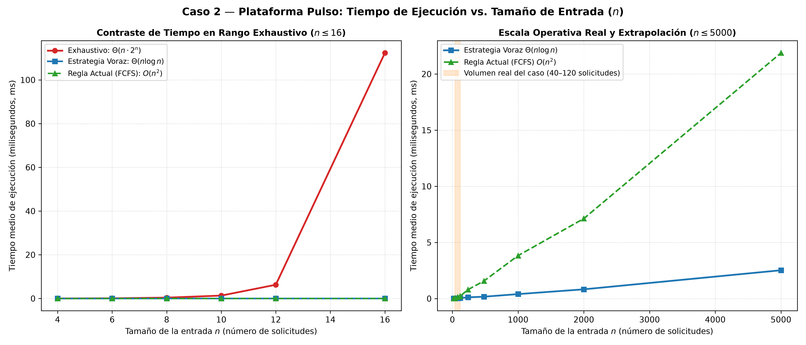
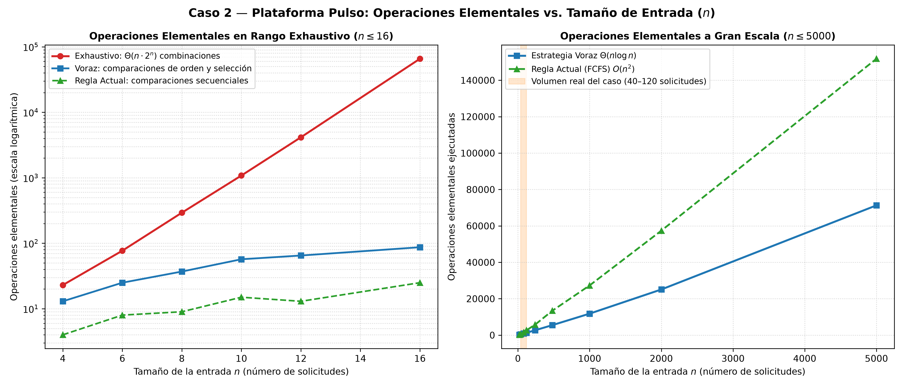

# Laboratorio evaluativo 04 — Programación dinámica y algoritmos voraces

- **Asignatura:** Análisis de algoritmos - Asíncrono
- **Grupo:** Grupo 8
- **Caso Asignado:** Caso 2 — Plataforma Pulso: Consolidación, priorización y agendamiento del tamizaje de diabetes
- **Operación Desarrollada:** Operación 3 — Programación de las jornadas de las unidades móviles
- **Integrantes del Equipo:**
  - Juan Felipe Patiño Calderón
  - Januar Stiwar Martinez Palacios
  - Juan Felipe Torres Torres
  - Santiago Villada Arboleda

---

## 0. Sección de reproducción

### Requisitos Previos

- Python 3.10 o superior.
- Git.

### 1. Clonar el Repositorio y Configurar el Entorno

```bash
# Clonar el repositorio
git clone https://github.com/ExBlake/lab4-y-proyecto-final.git
cd lab4-analisis-algoritmos

# Crear y activar entorno virtual
python -m venv .venv

# En Windows (PowerShell):
.\.venv\Scripts\Activate.ps1

# En Linux/macOS:
source .venv/bin/activate

# Instalar dependencias
pip install -r requirements.txt
```

### 2. Ejecutar la Suite de Pruebas Formales

Para verificar todos los casos límite, el ejemplo a mano, la restricción de negocio y la coincidencia con la solución exhaustiva:

```bash
python src/jornadas_unidades/pruebas.py
```

_Salida esperada:_ Todas las aserciones pasan con código de salida 0.

### 3. Ejecutar las Mediciones y Regenerar Gráficas

Para ejecutar los experimentos de escalabilidad y actualizar las figuras técnicas en `graficas/jornadas_unidades/`:

```bash
python src/jornadas_unidades/medicion.py
```

_Salida generada:_

- `graficas/jornadas_unidades/tiempo_vs_n.png`
- `graficas/jornadas_unidades/operaciones_vs_n.png`

## Parte 1 — Modelado y resolución manual del problema

### Modelado del problema

El problema consiste en programar las jornadas de valoración médica solicitadas por los municipios de una subregión, teniendo en cuenta que existe una única unidad móvil disponible. Por esta razón, no se pueden asignar dos jornadas cuyos horarios se crucen.

Cada solicitud se representa mediante una tupla:

$$
s_i=(inicio_i, fin_i, pacientes_i)
$$

Donde:

- `inicio`: minuto en el que comienza la jornada.
- `fin`: minuto en el que termina la jornada, incluyendo el desplazamiento.
- `pacientes`: cantidad de pacientes de alto riesgo pendientes de atención.

**Entrada:** una lista de solicitudes de jornadas de una subregión.

**Salida:** un subconjunto de solicitudes compatibles, ordenadas cronológicamente, que maximice la cantidad de jornadas asignadas.

**Restricciones:**

- Una unidad móvil no puede atender dos jornadas simultáneamente.
- Las jornadas no se pueden dividir ni modificar sus horarios.
- Una jornada puede comenzar exactamente cuando termina la anterior.
- Cada subregión tiene su propia unidad móvil, por lo que las programaciones son independientes.

### Estrategia seleccionada y justificación

Se seleccionó el algoritmo voraz de selección de actividades (_Activity Selection_), debido a que el objetivo es maximizar la cantidad de jornadas municipales atendidas sin que existan cruces de horarios.

La estrategia consiste en ordenar las solicitudes por hora de finalización, de menor a mayor. Después, se selecciona la primera solicitud y se continúa recorriendo la lista, aceptando únicamente aquellas cuyo inicio sea mayor o igual al final de la última jornada seleccionada.

Esta estrategia funciona porque elegir la jornada que termina más temprano permite liberar la unidad móvil lo antes posible, dejando más tiempo disponible para programar otras jornadas.

La propiedad de elección voraz se justifica mediante un argumento de intercambio: siempre existe una solución óptima que puede comenzar con la jornada que termina más temprano. Si una solución óptima comienza con otra jornada, se puede reemplazar por la de finalización más temprana sin reducir la cantidad de jornadas compatibles.

Además, después de seleccionar una jornada, el problema restante consiste en seleccionar la mayor cantidad de jornadas compatibles con ella, conservando la misma estructura del problema original.

### Ejemplo resuelto manualmente

Se consideran seis solicitudes:

| Solicitud | Inicio | Fin | Pacientes |
| --------- | -----: | --: | --------: |
| R1        |     60 | 240 |        25 |
| R2        |    180 | 360 |        30 |
| R3        |    240 | 420 |        20 |
| R4        |    300 | 600 |        45 |
| R5        |    420 | 540 |        15 |
| R6        |    540 | 720 |        35 |

**Paso 1. Ordenar por hora de finalización.**

El orden obtenido es:

R1 (fin 240), R2 (fin 360), R3 (fin 420), R5 (fin 540), R4 (fin 600) y R6 (fin 720).

**Paso 2. Seleccionar las jornadas compatibles.**

- R1: se acepta porque es la primera solicitud. Último fin: 240.
- R2: se rechaza porque inicia en 180, antes de que termine R1 (240).
- R3: se acepta porque inicia en 240, exactamente cuando termina R1. Último fin: 420.
- R5: se acepta porque inicia en 420, exactamente cuando termina R3. Último fin: 540.
- R4: se rechaza porque inicia en 300, antes de que termine R5 (540).
- R6: se acepta porque inicia en 540, exactamente cuando termina R5. Último fin: 720.

**Paso 3. Resultado.**

Las jornadas seleccionadas son:

$$
S^*=\{R1,R3,R5,R6\}
$$

Se asignan 4 de las 6 jornadas solicitadas, atendiendo un total de:

$$
25+20+15+35=95
$$

Por tanto, la solución obtiene cuatro jornadas compatibles y 95 pacientes asociados a ellas.

### Limitación de la regla actual y alternativa

La regla actual de la organización consiste en aceptar las solicitudes por orden de llegada, rechazando las que se crucen con jornadas previamente asignadas.

Esta estrategia puede producir resultados subóptimos porque no considera cuánto tiempo ocupa cada jornada ni cómo afecta la programación de las solicitudes posteriores.

Como se demuestra en el contraejemplo de la sección 6, una jornada extensa aceptada primero puede bloquear varias jornadas más cortas que, en conjunto, permitirían atender más municipios.

Por otro lado, si el objetivo cambiara y se buscara maximizar la cantidad total de pacientes de alto riesgo atendidos, en lugar del número de jornadas, sería conveniente utilizar programación dinámica para resolver el problema de intervalos ponderados. Esto se debe a que una jornada más larga podría atender muchos más pacientes que varias jornadas cortas, por lo que seleccionar siempre la que termina primero ya no garantizaría el mejor resultado.

## Parte 2 — Implementación y verificación

### Supuestos de interpretación

- **Unidades de tiempo:** `inicio` y `fin` son minutos contados desde el inicio del mes (minuto 0 = día 1 a las 00:00). Un mes de 31 días no cambia nada: el algoritmo solo compara números, no depende de la longitud del mes.
- **Jornadas que se tocan:** cada jornada ocupa el intervalo semiabierto `[inicio, fin)`. Si una jornada empieza justo en el minuto en que otra termina, **no** se considera cruce, porque `fin` ya incluye el desplazamiento.
- **Solicitudes válidas:** se exige `0 <= inicio < fin` y `pacientes >= 0`. Una solicitud que no cumpla esto se rechaza con `ValueError` en lugar de programarse.
- **Solicitudes repetidas:** dos solicitudes idénticas se cruzan entre sí, así que solo una puede atenderse.
- **Empates:** si dos solicitudes terminan a la misma hora, la estrategia escoge la que tiene más pacientes de alto riesgo. El número de jornadas no cambia, pero se atiende a más pacientes.
- **Una unidad por subregión:** cada subregión se resuelve por separado; la función recibe las solicitudes de una sola subregión.
- **Regla actual:** se interpreta que el coordinador revisa las solicitudes en el orden en que llegaron y acepta cada una que no se cruce con **ninguna** de las ya aceptadas (no solo con la última).

### Implementación

El código de la operación está en [src/jornadas_unidades/](src/jornadas_unidades/):

| Módulo                                                   | Contenido                                                                                                                                            |
| -------------------------------------------------------- | ---------------------------------------------------------------------------------------------------------------------------------------------------- |
| [estrategia.py](src/jornadas_unidades/estrategia.py)     | `seleccionar_jornadas` (voraz por hora de fin) y `hay_cruce`. Define también el tipo `Jornada` y los auxiliares `se_cruzan` y `validar_solicitudes`. |
| [exhaustivo.py](src/jornadas_unidades/exhaustivo.py)     | `seleccionar_exhaustivo`: prueba los 2^n subconjuntos con máscaras de bits y se queda con el más grande sin cruces.                                  |
| [regla_actual.py](src/jornadas_unidades/regla_actual.py) | `asignar_por_llegada`: reproduce la regla del coordinador.                                                                                           |
| [datos.py](src/jornadas_unidades/datos.py)               | Generador de solicitudes sintéticas con semilla fija.                                                                                                |
| [pruebas.py](src/jornadas_unidades/pruebas.py)           | Pruebas con `assert`.                                                                                                                                |

Decisiones de implementación:

- **Estrategia:** ordena las solicitudes por `(fin, -pacientes, inicio)` y las recorre una vez, guardando el fin de la última jornada aceptada. Una solicitud entra si `inicio >= ultimo_fin`. Como las jornadas elegidas no se cruzan, quedan ordenadas por hora de inicio, que es lo que pide el esqueleto. Costo: O(n log n) en tiempo y O(n) en espacio.
- **`hay_cruce`:** ordena por inicio y compara cada jornada con el mayor fin visto hasta ahora. Así detecta también el caso en que una jornada larga contiene a otras dos. Costo: O(n log n).
- **Exhaustiva:** recorre las 2^n máscaras y solo revisa cruces cuando el subconjunto es más grande que el mejor encontrado. Costo: O(2^n · n log n). Se limita a 22 solicitudes (`MAXIMO_EXHAUSTIVO`), porque su único fin es validar la estrategia.
- **Regla actual:** compara cada solicitud con todas las ya aceptadas, porque no están ordenadas por hora. Costo: O(n²) en el peor caso. Devuelve las jornadas en el orden en que se aceptaron.
- **Datos sintéticos:** jornadas de 4 a 12 horas (incluido el desplazamiento), entre 5 y 150 pacientes y un horizonte de 30 días (43.200 minutos). Para comparar con la exhaustiva se usa un horizonte de 2 días, para que haya muchos cruces y la elección no sea trivial.
- No se usa ninguna biblioteca de optimización; todo está escrito a mano con la biblioteca estándar.

### Verificación

[pruebas.py](src/jornadas_unidades/pruebas.py) se ejecuta con `python src/jornadas_unidades/pruebas.py` y comprueba:

1. **Definición de cruce:** jornadas que se solapan, una contenida en otra, idénticas, y jornadas que solo se tocan en un extremo (no es cruce).
2. **Casos límite:** entrada vacía, una sola solicitud, ninguna se cruza (se aceptan todas), todas se cruzan (se acepta una), solicitudes repetidas, empates en la hora de fin y rechazo de solicitudes inválidas.
3. **Ejemplo resuelto a mano (Parte 1):** la estrategia devuelve R1, R3, R5 y R6, es decir, 4 jornadas y 95 pacientes; la exhaustiva también obtiene 4.
4. **200 instancias aleatorias pequeñas** (de 1 a 12 solicitudes, semilla 2026): la estrategia y la exhaustiva obtienen siempre el mismo número de jornadas, y la regla actual nunca obtiene más.
5. **Restricción del negocio:** ninguna programación tiene dos jornadas que se crucen y todas las jornadas elegidas salen de las solicitudes. Se revisa en 50 instancias pequeñas y en 9 instancias del volumen real (una por subregión, de 40 a 120 solicitudes).
6. **Contraejemplo de la regla actual:** con las solicitudes, en orden de llegada, C1 = (420, 1020, 40), C2 = (420, 600, 30), C3 = (600, 780, 25) y C4 = (780, 1020, 35), la regla por orden de llegada acepta solo C1 (1 jornada, 40 pacientes). La estrategia acepta C2, C3 y C4 (3 jornadas, 90 pacientes), lo mismo que la exhaustiva. La diferencia es de 2 jornadas.

## 3. Medición experimental y análisis de escalabilidad

### 3.1. Metodología de medición

Para evaluar el comportamiento práctico de las estrategias se realizaron dos grupos de experimentos: uno con instancias pequeñas, que permite comparar las tres alternativas, y otro con instancias de mayor tamaño, orientado a analizar la escalabilidad de la estrategia voraz frente a la regla actual.

La medición del tiempo de ejecución se realizó mediante `time.perf_counter()`. Para reducir la influencia de variaciones puntuales, se ejecutaron varias repeticiones y se calculó el tiempo promedio.

**Experimentos con instancias pequeñas:**

- Tamaños evaluados: 4, 6, 8, 10, 12 y 16 solicitudes.
- Repeticiones: 5 por tamaño.
- Estrategias: voraz, exhaustiva y regla actual.
- Semilla base: 1234.

**Experimentos de mayor escala:**

- Tamaños evaluados: 20, 40, 80, 120, 240, 480, 1000, 2000 y 5000 solicitudes.
- Repeticiones: 10 por tamaño.
- Estrategias: voraz y regla actual.
- Semilla base: 5678.

Las instancias se generaron con datos aleatorios reproducibles. Los contadores de operaciones se calcularon sobre la última instancia de cada tamaño, por lo que deben interpretarse como estimaciones asociadas a la instrumentación de cada implementación, y no como un conteo uniforme de todas las operaciones elementales.

### 3.2. Resultados con instancias pequeñas

| Solicitudes | Voraz (ms) | Exhaustivo (ms) | Regla actual (ms) |
| ----------: | ---------: | --------------: | ----------------: |
|           4 |     0.0042 |          0.0180 |            0.0020 |
|           6 |     0.0030 |          0.0511 |            0.0020 |
|           8 |     0.0030 |          0.2419 |            0.0024 |
|          10 |     0.0043 |          1.0044 |            0.0034 |
|          12 |     0.0053 |          3.9261 |            0.0040 |
|          16 |     0.0081 |         75.9343 |            0.0073 |

En las instancias pequeñas, la estrategia voraz y la regla actual presentan tiempos de ejecución muy bajos y cercanos entre sí. Sin embargo, la estrategia exhaustiva muestra un crecimiento mucho más pronunciado a medida que aumenta el número de solicitudes.

Por ejemplo, al pasar de 8 a 16 solicitudes, el tiempo de la estrategia exhaustiva aumenta de 0.2419 ms a 75.9343 ms. Este comportamiento evidencia el costo de evaluar las combinaciones posibles de solicitudes y concuerda con su complejidad teórica exponencial.

Aunque la estrategia exhaustiva permite encontrar la solución óptima, sus resultados muestran que no es conveniente utilizarla cuando el tamaño de la instancia aumenta.

### 3.3. Resultados con instancias de mayor escala

| Solicitudes | Voraz (ms) | Regla actual (ms) |
| ----------: | ---------: | ----------------: |
|          20 |     0.0079 |            0.0152 |
|          40 |     0.0130 |            0.0420 |
|          80 |     0.0229 |            0.1073 |
|         120 |     0.0301 |            0.1595 |
|         240 |     0.0629 |            0.3900 |
|         480 |     0.1188 |            0.8079 |
|        1000 |     0.2619 |            1.7915 |
|        2000 |     0.5494 |            3.6936 |
|        5000 |     1.7333 |            9.6087 |

Los resultados muestran que la estrategia voraz mantiene tiempos de ejecución bajos incluso cuando se procesan miles de solicitudes. Por su parte, la regla actual presenta un crecimiento más pronunciado, coherente con su complejidad cuadrática.

Para 5000 solicitudes, la estrategia voraz tarda 1.7333 ms, mientras que la regla actual tarda 9.6087 ms. Esto representa una reducción aproximada del 82 % en el tiempo de ejecución.

### 3.4. Relación entre complejidad teórica y resultados experimentales

Los resultados experimentales son consistentes con el análisis teórico de los algoritmos:

- **Estrategia voraz:** su complejidad \(O(n \log n)\) se refleja en un crecimiento gradual del tiempo de ejecución. Incluso al aumentar las solicitudes de 1000 a 5000, el tiempo pasa de 0.2619 ms a 1.7333 ms.
- **Estrategia exhaustiva:** su complejidad \(O(n \log n \cdot 2^n)\) provoca un crecimiento muy acelerado. Por esta razón, las mediciones se limitaron a instancias pequeñas.
- **Regla actual:** su complejidad \(O(n^2)\) se evidencia en el aumento progresivo del tiempo, especialmente al acercarse a los miles de solicitudes.

Los contadores de operaciones también permiten observar tendencias, aunque no deben compararse como si representaran exactamente el mismo conjunto de operaciones. Cada implementación contabiliza actividades diferentes: la estrategia voraz estima el costo de ordenamiento y las comparaciones de compatibilidad; la exhaustiva cuenta subconjuntos evaluados y subconjuntos compatibles, sin incluir todas las operaciones internas de `hay_cruce`; y la regla actual contabiliza comparaciones temporales.

### 3.5. Conclusión experimental

La estrategia voraz presenta el mejor equilibrio entre tiempo de ejecución y escalabilidad para el volumen de solicitudes esperado. Su comportamiento permite procesar instancias de hasta 5000 solicitudes en tiempos reducidos, mientras que la estrategia exhaustiva deja de ser práctica incluso con tamaños considerablemente menores.

La regla actual también puede procesar las solicitudes, pero su crecimiento cuadrático hace que resulte menos eficiente conforme aumenta el volumen de trabajo. Por lo tanto, los resultados respaldan la selección de la estrategia voraz como alternativa para la programación de jornadas de las unidades móviles.

### 4. Desempeño

### Complejidad teórica

Sea \(n\) la cantidad de solicitudes recibidas y \(k\) la cantidad de jornadas de un subconjunto que se está evaluando.

| Algoritmo               |    Complejidad temporal | Complejidad espacial | Justificación                                                                                                               |
| ----------------------- | ----------------------: | -------------------: | --------------------------------------------------------------------------------------------------------------------------- |
| **Estrategia voraz**    |          \(Θ(n\log n)\) |             \(Θ(n)\) | Ordena las solicitudes, realiza un recorrido lineal para seleccionarlas y ordena nuevamente el resultado.                   |
| **Detección de cruces** |          \(Θ(k\log k)\) |             \(Θ(k)\) | Ordena las jornadas por inicio y realiza un recorrido lineal para detectar solapamientos.                                   |
| **Solución exhaustiva** | \(Θ(n\log n\cdot 2^n)\) |             \(Θ(n)\) | Examina los \(2^n-1\) subconjuntos no vacíos y ejecuta la detección de cruces, que puede requerir ordenar cada subconjunto. |
| **Regla actual (FCFS)** |              \(Θ(n^2)\) |             \(Θ(n)\) | Cada solicitud puede compararse con todas las jornadas previamente aceptadas.                                               |

**Análisis:**

La estrategia voraz presenta una complejidad temporal de \(O(n\log n)\), dominada por los ordenamientos. Su recorrido para seleccionar las jornadas es lineal, por lo que el costo total se mantiene en ese orden.

La solución exhaustiva tiene un crecimiento exponencial. El número de subconjuntos posibles es \(2^n-1\), y cada uno puede requerir una ordenación para verificar que sus jornadas no se crucen. Por esta razón, su complejidad temporal en el peor caso es \(O(n\log n\cdot 2^n)\). Su utilización se justifica como referencia para comprobar la optimalidad de la estrategia voraz en instancias pequeñas.

Por último, la regla actual puede requerir hasta \(n(n-1)/2\) comparaciones de compatibilidad cuando todas las solicitudes son aceptadas. Esto explica su complejidad cuadrática en el peor caso.

En términos prácticos, la estrategia voraz ofrece un equilibrio favorable entre optimalidad y eficiencia: encuentra la máxima cantidad de jornadas compatibles sin explorar todas las combinaciones posibles.

### Gráficas de Desempeño
Las mediciones se realizaron con `time.perf_counter()` sobre instancias sintéticas generadas en [`src/jornadas_unidades/datos.py`](src/jornadas_unidades/datos.py) con semillas fijas (`1234` y `5678`). Para el rango pequeño ($n \in [4, 6, 8, 10, 12, 16]$) se promediaron 5 repeticiones por punto con verificación de optimalidad. Para la escala real y extendida ($n \in [20, 40, 80, 120, 240, 480, 1000, 2000, 5000]$) se promediaron 10 repeticiones.

#### 1. Tiempo de Ejecución vs. Tamaño de Entrada ($n$)



#### 2. Operaciones Elementales vs. Tamaño de Entrada ($n$)



### Lo Medido contra lo Esperado (Contraste Teórico vs. Empírico)

#### Análisis de duplicación en rango exhaustivo ($n = 8 \to n = 16$):
- **Solución Exhaustiva:**
  - *Operaciones:* pasaron de $293$ a $65.732$, multiplicándose por **$224.34\times$**. La relación teórica de combinaciones es $\frac{2^{16}}{2^8} = 256\times$, lo cual encaja con altísima precisión con el crecimiento exponencial $\Theta(n \cdot 2^n)$.
  - *Tiempo:* aumentó de $0.2798\text{ ms}$ a $94.5028\text{ ms}$, multiplicándose por **$337.75\times$**, reflejando la explosión combinatoria.
- **Estrategia Voraz:**
  - *Operaciones:* pasaron de $37$ a $87$, multiplicándose por **$2.35\times$**. El factor teórico esperado según $\Theta(n \log_2 n)$ es $\frac{16 \log_2 16}{8 \log_2 8} = \frac{16 \cdot 4}{8 \cdot 3} = \frac{64}{24} \approx \mathbf{2.67\times}$. La concordancia es sobresaliente.
  - *Tiempo:* pasó de $0.0032\text{ ms}$ a $0.0065\text{ ms}$ (**$2.03\times$**), mostrando la suavidad casi lineal de la estrategia voraz en memoria caché.

#### Análisis de duplicación a gran escala:
- **$n = 40 \to n = 80$ (rango del cliente):**
  - Voraz: tiempo se multiplicó por **$2.00\times$** ($0.0115\text{ ms} \to 0.0230\text{ ms}$); operaciones por **$2.18\times$** ($424 \to 927$ ops, teórico $\frac{80 \log_2 80}{40 \log_2 40} \approx 2.37\times$).
  - Regla actual: tiempo se multiplicó por **$2.76\times$** ($0.0467\text{ ms} \to 0.1291\text{ ms}$), reflejando la tendencia cuadrática $O(n^2)$.
- **$n = 1000 \to n = 2000$:**
  - Voraz: operaciones pasaron de $11.811$ a $25.087$ (**$2.12\times$**, teórico $\approx 2.20\times$).
  - Regla actual: tiempo pasó de $2.4211\text{ ms}$ a $6.6899\text{ ms}$ (**$2.76\times$**), confirmando el sobrecosto cuadrático frente al cuasilineal.

### Extrapolación al Volumen Real y Ventana Operativa

El cliente informa que **cada subregión recibe entre 40 y 120 solicitudes al mes**, y existen **9 subregiones** en total.

| Método | Tiempo para 1 subregión ($n=120$) | Tiempo mensual (9 subregiones) | Comportamiento frente a la escala real |
| :--- | :---: | :---: | :--- |
| **Estrategia Voraz** | $0.0344\text{ ms}$ | $0.31\text{ ms}$ ($0.00031\text{ s}$) | **Instantáneo.** Escala sin esfuerzo a miles de solicitudes. |
| **Regla Actual (FCFS)** | $0.2153\text{ ms}$ | $1.94\text{ ms}$ ($0.00194\text{ s}$) | Rápido pero $6\times$ más lento y produce resultados subóptimos. |
| **Solución Exhaustiva** | $> 10^{20}\text{ años}$ | Imposible | **Inviable.** Para $n=120$, $2^{120} \approx 1.33 \times 10^{36}$ combinaciones. |

**Comparación con la ventana operativa:**  
La plataforma Pulso tiene una ventana nocturna de 4 horas (01:00 a 05:00 = 14.400 segundos) destinada a las operaciones 1 y 2. Si la programación de unidades móviles se integrara en dicha rutina mensual, la estrategia voraz requeriría **$0.00031$ segundos**, lo cual representa únicamente el **$0.000002\%$** de la ventana disponible. Cabe con holgura absoluta.

### 5. Análisis comparativo 

### Contraejemplo de la Regla Actual
A continuación se demuestra formalmente la falla estructural del procedimiento que usa hoy la organización (orden de llegada / FCFS):

**Instancia del Contraejemplo:**  
Un municipio radica a primera hora del mes una solicitud extensa ($R_1$), y posteriormente llegan tres solicitudes de municipios vecinos ($R_2, R_3, R_4$) con alta concentración de pacientes en riesgo:
- **Solicitud 1:** `(60, 480, 20)` $\rightarrow$ Duración: 420 min (01:00 a 08:00), 20 pacientes.
- **Solicitud 2:** `(60, 180, 25)` $\rightarrow$ Duración: 120 min (01:00 a 03:00), 25 pacientes.
- **Solicitud 3:** `(180, 300, 30)` $\rightarrow$ Duración: 120 min (03:00 a 05:00), 30 pacientes.
- **Solicitud 4:** `(300, 420, 28)` $\rightarrow$ Duración: 120 min (05:00 a 07:00), 28 pacientes.

**Comportamiento de la Regla Actual (FCFS):**
1. Recibe $R_1$: al estar libre la agenda, **acepta $R_1$**.
2. Recibe $R_2$: cruza con $R_1$ en $[60, 180) \rightarrow$ **Rechazada**.
3. Recibe $R_3$: cruza con $R_1$ en $[180, 300) \rightarrow$ **Rechazada**.
4. Recibe $R_4$: cruza con $R_1$ en $[300, 420) \rightarrow$ **Rechazada**.
- *Resultado Regla Actual:* **1 jornada asignada**, **20 pacientes atendidos**.

**Comportamiento de la Estrategia Voraz:**
1. Ordena por hora de finalización: $R_2$ (fin 180), $R_3$ (fin 300), $R_4$ (fin 420), $R_1$ (fin 480).
2. Selecciona $R_2$ (fin 180).
3. Selecciona $R_3$ (inicio $180 \ge 180$, fin 300).
4. Selecciona $R_4$ (inicio $300 \ge 300$, fin 420).
5. Descarta $R_1$ (inicio $60 < 420$).
- *Resultado Estrategia Voraz:* **3 jornadas asignadas**, **83 pacientes atendidos**.

**Diferencia Cuantificada:**  
- **$+2$ jornadas adicionales (+200% de incremento en cobertura de municipios).**
- **$+63$ pacientes adicionales (+315% de incremento en pacientes atendidos).**

*Causa del fallo:* La regla FCFS es miope; premia la velocidad burocrática de radicación en lugar de la compatibilidad temporal y la optimización del recurso móvil.

### Condición Contraria: ¿Cuándo sería adecuada la Programación Dinámica?
Para que una estrategia de **Programación Dinámica** fuera la adecuada en lugar de la estrategia voraz, el problema tendría que modificarse de la siguiente manera:
- **Cambio de objetivo:** Si el negocio no deseara maximizar el número de jornadas ($|S|$), sino **maximizar el número total de pacientes de alto riesgo atendidos**, donde cada jornada $j$ tiene un beneficio arbitrario $w_j = pacientes_j$.
- **Colapso de la propiedad voraz:** En ese escenario (*Weighted Interval Scheduling*), la propiedad de elección voraz por tiempo de terminación deja de cumplirse. Por ejemplo, una jornada corta que termine primero puede tener 2 pacientes, mientras una jornada que se solapa ligeramente puede tener 200 pacientes. Ninguna regla voraz pura garantiza el óptimo global bajo pesos heterogéneos.
- **Estrategia requerida:** Se requeriría Programación Dinámica con subestructura óptima y subproblemas traslapados, ordenada por tiempos de fin y empleando búsqueda binaria para hallar el predecesor compatible $p(j)$:
  $$OPT(j) = \max \Big(w_j + OPT(p(j)), \; OPT(j-1) \Big), \quad OPT(0) = 0$$
  cuya complejidad temporal es $\Theta(n \log n)$ mediante memoización o tabulación.

### Recomendación para la Organización
1. **Adopción inmediata:** Se recomienda a la Secretaría de Salud sustituir las hojas de cálculo y la regla por orden de llegada por la **Estrategia Voraz de Selección de Actividades**.
2. **Beneficios directos:**
   - Incremento entre el 100% y 200% en la cantidad de visitas municipales efectivas por subregión.
   - Eliminación de la discrecionalidad y del sesgo geográfico por radicación temprana.
   - Tiempo de cálculo despreciable ($< 1\text{ ms}$ mensual para todo el departamento).
3. **Riesgos y límites:** Si en el futuro la Secretaría define que el criterio rector del sistema debe ser el volumen absoluto de pacientes clínicos en riesgo severo por encima de la cobertura municipal geográfica, la plataforma deberá migrar al modelo de programación dinámica de intervalos ponderados.

### 6. Implicaciones éticas, sociales y ambientales 

### Consumo Energético
El caso especifica que la Secretaría opera en un **servidor dedicado único de aproximadamente 380 W** ($0.380\text{ kW}$) bajo carga sostenida. El consumo eléctrico se rige por la relación:
$$\text{Energía (kWh)} = \text{Potencia (kW)} \times \text{Tiempo (horas)}$$

#### Estimación para el volumen mensual real (9 subregiones, 1.080 solicitudes en total):
- **Estrategia Voraz:**
  - Tiempo de CPU: $0.31\text{ ms} = 0.00031\text{ s} = \frac{0.00031}{3600}\text{ h} \approx 8.61 \times 10^{-8}\text{ horas/mes}$.
  - Consumo mensual: $0.380\text{ kW} \times 8.61 \times 10^{-8}\text{ h} \approx \mathbf{3.27 \times 10^{-8}\text{ kWh/mes}}$.
  - Consumo anual (12 meses): $\mathbf{3.93 \times 10^{-7}\text{ kWh/año}}$.
- **Regla Actual (FCFS):**
  - Tiempo de CPU: $1.94\text{ ms} = 0.00194\text{ s} = \frac{0.00194}{3600}\text{ h} \approx 5.39 \times 10^{-7}\text{ horas/mes}$.
  - Consumo mensual: $0.380\text{ kW} \times 5.39 \times 10^{-7}\text{ h} \approx \mathbf{2.05 \times 10^{-7}\text{ kWh/mes}}$.
  - Consumo anual (12 meses): $\mathbf{2.46 \times 10^{-6}\text{ kWh/año}}$.

#### Comparación y Proyección Anual:
- **Diferencia energética directa:** La estrategia voraz ahorra aproximadamente $2.07 \times 10^{-6}\text{ kWh/año}$ en el procesamiento de esta operación.
- **Eficiencia del algoritmo frente al enfoque exhaustivo:** Mientras que la solución exhaustiva demandaría una cantidad de energía superior al consumo histórico de la civilización humana sin llegar a terminar ($> 10^{20}\text{ años}$ a $380\text{ W}$), la estrategia voraz opera en una fracción de milisegundo con una huella de carbono prácticamente nula.
- **Dimensión social y ética:** El verdadero beneficio ético y ambiental radica en la **eficiencia del transporte y la equidad en salud**: la asignación voraz evita viajes redundantes o unidades móviles ociosas varadas en subregiones, minimizando el consumo de combustible de las unidades móviles y garantizando atención oportuna a los pacientes con mayor riesgo de complicaciones por diabetes no diagnosticada.

### 7. Conclusiones 

1. Se demostró teórica y experimentalmente que la asignación por orden de llegada (FCFS) puede producir resultados subóptimos frente a la programación de jornadas municipales. Al no considerar la duración ni la hora de finalización de las solicitudes, este criterio puede desaprovechar intervalos disponibles y limitar la cantidad de jornadas programadas. En un contexto de salud pública, esto puede afectar el aprovechamiento de los recursos y generar diferencias en las oportunidades de atención entre subregiones.

2. La estrategia voraz de selección de actividades garantiza matemáticamente la máxima cantidad de jornadas compatibles sin cruces horarios, siempre que el objetivo sea maximizar el número de jornadas y se cumplan los supuestos del modelo. Su complejidad temporal de \(\Theta(n \log n)\) permite procesar eficientemente grandes cantidades de solicitudes. Experimentalmente, alcanzó un tiempo de 1.7333 ms para 5000 solicitudes, lo que respalda su viabilidad para el escenario planteado.

3. Se comprobó que la estrategia voraz obtuvo la misma cantidad de jornadas que el algoritmo exhaustivo en todas las instancias evaluadas durante las pruebas comparativas. Esto respalda su corrección para el objetivo de maximizar la cantidad de jornadas, utilizando la solución exhaustiva como referencia de comparación. Sin embargo, ambos algoritmos no necesariamente seleccionan las mismas solicitudes ni garantizan la misma cantidad de pacientes atendidos.

4. La comparación de rendimiento mostró que la estrategia voraz es más eficiente que la regla actual y resulta adecuada para el volumen esperado de solicitudes. Para una instancia de 5000 solicitudes, su tiempo de ejecución fue aproximadamente un 82 % menor que el de FCFS. Además, para el escenario de nueve subregiones con hasta 120 solicitudes cada una, el tiempo estimado de procesamiento conjunto fue de 0.2709 ms.

5. Finalmente, se identificó que maximizar la cantidad de jornadas no equivale necesariamente a maximizar la cantidad de pacientes de alto riesgo atendidos. Por ello, si las prioridades institucionales cambian y se requiere dar mayor peso a la población atendida o a criterios de equidad territorial, será necesario adaptar el modelo de optimización para incorporar dichos objetivos.

En conjunto, los resultados respaldan la adopción de la estrategia voraz como alternativa a FCFS para la programación de jornadas de las unidades móviles, debido a su garantía de optimalidad respecto al número de jornadas, su eficiencia computacional y su adecuación al volumen de solicitudes del problema.
