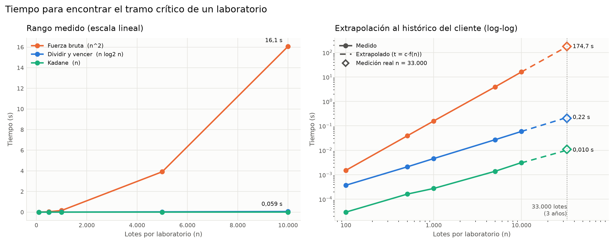

# Laboratorio evaluativo 04 — Programación dinámica y algoritmos voraces

- **Asignatura:** Análisis de algoritmos - Asíncrono
- **Grupo:** Grupo 8
- **Caso Asignado:** Caso 2 — Plataforma Pulso: Consolidación, priorización y agendamiento del tamizaje de diabetes
- **Operación Desarrollada:** Operación 3 — Programación de las jornadas de las unidades móviles
- **Integrantes del Equipo:**
  - Juan Felipe Patiño Calderón
  - Januar Stiwar Martinez Palacios
  - Juan Felipe Torres Torres
  - Santiago Villada Arboleda

---

## 0. Sección de reproducción

### Requisitos Previos

- Python 3.10 o superior.
- Git.

### 1. Clonar el Repositorio y Configurar el Entorno

```bash
# Clonar el repositorio
git clone https://github.com/ExBlake/lab4-y-proyecto-final.git
cd lab4-analisis-algoritmos

# Crear y activar entorno virtual
python -m venv .venv

# En Windows (PowerShell):
.\.venv\Scripts\Activate.ps1

# En Linux/macOS:
source .venv/bin/activate

# Instalar dependencias
pip install -r requirements.txt
```

### 2. Ejecutar la Suite de Pruebas Formales

Para verificar todos los casos límite, el ejemplo a mano, la restricción de negocio y la coincidencia con la solución exhaustiva:

```bash
python src/jornadas_unidades/pruebas.py
```

_Salida esperada:_ Todas las aserciones pasan con código de salida 0.

### 3. Ejecutar las Mediciones y Regenerar Gráficas

Para ejecutar los experimentos de escalabilidad y actualizar las figuras técnicas en `graficas/jornadas_unidades/`:

```bash
python src/jornadas_unidades/medicion.py
```

_Salida generada:_

- `graficas/jornadas_unidades/tiempo_vs_n.png`
- `graficas/jornadas_unidades/operaciones_vs_n.png`

### 4. Operación 4 — Vigilancia de calidad: pruebas, mediciones y gráficas

```bash
# Pruebas de correctitud y equivalencia (fuerza bruta = dividir y vencer = Kadane)
python src/vigilancia_calidad/pruebas.py

# Mediciones (n = 100 ... 10.000), extrapolación, energía y las 3 gráficas (~2,5 min)
python src/vigilancia_calidad/medicion.py

# Igual que el anterior, y además mide una corrida real con n = 33.000 (~3 min extra)
python src/vigilancia_calidad/medicion.py --validar-volumen-real

# Solo regenerar las gráficas a partir de los CSV ya guardados (segundos)
python src/vigilancia_calidad/graficas.py
```

_Salida generada:_

- `experimentos/vigilancia_calidad/mediciones.csv`: tiempo de reloj, tiempo de CPU, memoria pico y energía por estrategia y tamaño.
- `experimentos/vigilancia_calidad/extrapolacion.csv`: constante ajustada, R², tiempo y energía para 290 laboratorios × 33.000 lotes y proyección anual.
- `experimentos/vigilancia_calidad/validacion_33000.csv`: tiempo predicho contra medido con n = 33.000 (solo con `--validar-volumen-real`).
- `experimentos/vigilancia_calidad/entorno.json`: máquina, versión de Python y parámetros con que se obtuvieron los datos.
- `graficas/vigilancia_calidad/escalabilidad_tiempo.png`, `consumo_energetico_anual.png` y `ajuste_teorico_complejidad.png`.

Los datos sintéticos se generan dentro del script con [`datos.py`](src/vigilancia_calidad/datos.py) (semilla base `2026`, una semilla distinta por tamaño), así que no hace falta descargar nada. Los tiempos absolutos dependen de la máquina; las razones entre tamaños y entre estrategias son las que deben reproducirse.

## Parte 1 — Modelado y resolución manual del problema

### Modelado del problema

El problema consiste en programar las jornadas de valoración médica solicitadas por los municipios de una subregión, teniendo en cuenta que existe una única unidad móvil disponible. Por esta razón, no se pueden asignar dos jornadas cuyos horarios se crucen.

Cada solicitud se representa mediante una tupla:

$$
s_i=(inicio_i, fin_i, pacientes_i)
$$

Donde:

- `inicio`: minuto en el que comienza la jornada.
- `fin`: minuto en el que termina la jornada, incluyendo el desplazamiento.
- `pacientes`: cantidad de pacientes de alto riesgo pendientes de atención.

**Entrada:** una lista de solicitudes de jornadas de una subregión.

**Salida:** un subconjunto de solicitudes compatibles, ordenadas cronológicamente, que maximice la cantidad de jornadas asignadas.

**Restricciones:**

- Una unidad móvil no puede atender dos jornadas simultáneamente.
- Las jornadas no se pueden dividir ni modificar sus horarios.
- Una jornada puede comenzar exactamente cuando termina la anterior.
- Cada subregión tiene su propia unidad móvil, por lo que las programaciones son independientes.

### Estrategia seleccionada y justificación

Se seleccionó el algoritmo voraz de selección de actividades (_Activity Selection_), debido a que el objetivo es maximizar la cantidad de jornadas municipales atendidas sin que existan cruces de horarios.

La estrategia consiste en ordenar las solicitudes por hora de finalización, de menor a mayor. Después, se selecciona la primera solicitud y se continúa recorriendo la lista, aceptando únicamente aquellas cuyo inicio sea mayor o igual al final de la última jornada seleccionada.

Esta estrategia funciona porque elegir la jornada que termina más temprano permite liberar la unidad móvil lo antes posible, dejando más tiempo disponible para programar otras jornadas.

La propiedad de elección voraz se justifica mediante un argumento de intercambio: siempre existe una solución óptima que puede comenzar con la jornada que termina más temprano. Si una solución óptima comienza con otra jornada, se puede reemplazar por la de finalización más temprana sin reducir la cantidad de jornadas compatibles.

Además, después de seleccionar una jornada, el problema restante consiste en seleccionar la mayor cantidad de jornadas compatibles con ella, conservando la misma estructura del problema original.

### Criterio de Selección y Recurrencia
- **Criterio Voraz:** En cada paso, elegir la jornada compatible no seleccionada cuya hora de finalización sea mínima:
  $$j^* = \arg\min_{j \in C_t} (fin_j), \quad \text{donde } C_t = \{j \in S \mid inicio_j \ge t_{\text{actual}}\}$$
  En caso de empate en la hora de finalización, se prioriza la solicitud con mayor cantidad de pacientes. Si también existe empate en la cantidad de pacientes, se utiliza la hora de inicio más temprana como segundo criterio. Estos desempates permiten obtener un resultado determinista, pero no modifican la garantía de maximizar la cantidad de jornadas compatibles.
- **Actualización:** $t_{\text{actual}} \leftarrow fin_{j^*}$ y $S^* \leftarrow S^* \cup \{j^*\}$.

### Ejemplo resuelto manualmente

Se consideran seis solicitudes:

| Solicitud | Inicio | Fin | Pacientes |
| --------- | -----: | --: | --------: |
| R1        |     60 | 240 |        25 |
| R2        |    180 | 360 |        30 |
| R3        |    240 | 420 |        20 |
| R4        |    300 | 600 |        45 |
| R5        |    420 | 540 |        15 |
| R6        |    540 | 720 |        35 |

**Paso 1. Ordenar por hora de finalización.**

El orden obtenido es:

R1 (fin 240), R2 (fin 360), R3 (fin 420), R5 (fin 540), R4 (fin 600) y R6 (fin 720).

**Paso 2. Seleccionar las jornadas compatibles.**

- R1: se acepta porque es la primera solicitud. Último fin: 240.
- R2: se rechaza porque inicia en 180, antes de que termine R1 (240).
- R3: se acepta porque inicia en 240, exactamente cuando termina R1. Último fin: 420.
- R5: se acepta porque inicia en 420, exactamente cuando termina R3. Último fin: 540.
- R4: se rechaza porque inicia en 300, antes de que termine R5 (540).
- R6: se acepta porque inicia en 540, exactamente cuando termina R5. Último fin: 720.

**Paso 3. Resultado.**

Las jornadas seleccionadas son:

$$
S^*=\{R1,R3,R5,R6\}
$$

Se asignan 4 de las 6 jornadas solicitadas, atendiendo un total de:

$$
25+20+15+35=95
$$

Por tanto, la solución obtiene cuatro jornadas compatibles y 95 pacientes asociados a ellas.

### Limitación de la regla actual y alternativa

La regla actual de la organización consiste en aceptar las solicitudes por orden de llegada, rechazando las que se crucen con jornadas previamente asignadas.

Esta estrategia puede producir resultados subóptimos porque no considera cuánto tiempo ocupa cada jornada ni cómo afecta la programación de las solicitudes posteriores.

Como se demuestra en el contraejemplo de la sección 5, una jornada extensa aceptada primero puede bloquear varias jornadas más cortas que, en conjunto, permitirían atender más municipios.

Por otro lado, si el objetivo cambiara y se buscara maximizar la cantidad total de pacientes de alto riesgo atendidos, en lugar del número de jornadas, sería conveniente utilizar programación dinámica para resolver el problema de intervalos ponderados. Esto se debe a que una jornada más larga podría atender muchos más pacientes que varias jornadas cortas, por lo que seleccionar siempre la que termina primero ya no garantizaría el mejor resultado.

## Parte 2 — Implementación y verificación

### Supuestos de interpretación

- **Unidades de tiempo:** `inicio` y `fin` son minutos contados desde el inicio del mes (minuto 0 = día 1 a las 00:00). Un mes de 31 días no cambia nada: el algoritmo solo compara números, no depende de la longitud del mes.
- **Jornadas que se tocan:** cada jornada ocupa el intervalo semiabierto `[inicio, fin)`. Si una jornada empieza justo en el minuto en que otra termina, **no** se considera cruce, porque `fin` ya incluye el desplazamiento.
- **Solicitudes válidas:** se exige `0 <= inicio < fin` y `pacientes >= 0`. Una solicitud que no cumpla esto se rechaza con `ValueError` en lugar de programarse.
- **Solicitudes repetidas:** dos solicitudes idénticas se cruzan entre sí, así que solo una puede atenderse.
- **Empates:** si dos solicitudes terminan a la misma hora, la estrategia escoge la que tiene más pacientes de alto riesgo. El número de jornadas no cambia, pero se atiende a más pacientes.
- **Una unidad por subregión:** cada subregión se resuelve por separado; la función recibe las solicitudes de una sola subregión.
- **Regla actual:** se interpreta que el coordinador revisa las solicitudes en el orden en que llegaron y acepta cada una que no se cruce con **ninguna** de las ya aceptadas (no solo con la última).

### Implementación

El código de la operación está en [src/jornadas_unidades/](src/jornadas_unidades/):

| Módulo                                                   | Contenido                                                                                                                                            |
| -------------------------------------------------------- | ---------------------------------------------------------------------------------------------------------------------------------------------------- |
| [estrategia.py](src/jornadas_unidades/estrategia.py)     | `seleccionar_jornadas` (voraz por hora de fin) y `hay_cruce`. Define también el tipo `Jornada` y los auxiliares `se_cruzan` y `validar_solicitudes`. |
| [exhaustivo.py](src/jornadas_unidades/exhaustivo.py)     | `seleccionar_exhaustivo`: prueba los 2^n subconjuntos con máscaras de bits y se queda con el más grande sin cruces.                                  |
| [regla_actual.py](src/jornadas_unidades/regla_actual.py) | `asignar_por_llegada`: reproduce la regla del coordinador.                                                                                           |
| [datos.py](src/jornadas_unidades/datos.py)               | Generador de solicitudes sintéticas con semilla fija.                                                                                                |
| [pruebas.py](src/jornadas_unidades/pruebas.py)           | Pruebas con `assert`.                                                                                                                                |

Decisiones de implementación:

- **Estrategia:** ordena las solicitudes por `(fin, -pacientes, inicio)` y las recorre una vez, guardando el fin de la última jornada aceptada. Una solicitud entra si `inicio >= ultimo_fin`. Como las jornadas elegidas no se cruzan, quedan ordenadas por hora de inicio, que es lo que pide el esqueleto. Costo: (n log n) en tiempo y O(n) en espacio.
- **`hay_cruce`:** ordena por inicio y compara cada jornada con el mayor fin visto hasta ahora. Así detecta también el caso en que una jornada larga contiene a otras dos. Costo: O(n log n).
- **Exhaustiva:** recorre las 2^n máscaras y solo revisa cruces cuando el subconjunto es más grande que el mejor encontrado. Costo: O(2^n · n log n). Se limita a 22 solicitudes (`MAXIMO_EXHAUSTIVO`), porque su único fin es validar la estrategia.
- **Regla actual:** compara cada solicitud con todas las ya aceptadas, porque no están ordenadas por hora. Costo: O(n²) en el peor caso. Devuelve las jornadas en el orden en que se aceptaron.
- **Datos sintéticos:** jornadas de 4 a 12 horas (incluido el desplazamiento), entre 5 y 150 pacientes y un horizonte de 30 días (43.200 minutos). Para comparar con la exhaustiva se usa un horizonte de 2 días, para que haya muchos cruces y la elección no sea trivial.
- No se usa ninguna biblioteca de optimización; todo está escrito a mano con la biblioteca estándar.

### Verificación

[pruebas.py](src/jornadas_unidades/pruebas.py) se ejecuta con `python src/jornadas_unidades/pruebas.py` y comprueba:

1. **Definición de cruce:** jornadas que se solapan, una contenida en otra, idénticas, y jornadas que solo se tocan en un extremo (no es cruce).
2. **Casos límite:** entrada vacía, una sola solicitud, ninguna se cruza (se aceptan todas), todas se cruzan (se acepta una), solicitudes repetidas, empates en la hora de fin y rechazo de solicitudes inválidas.
3. **Ejemplo resuelto a mano (Parte 1):** la estrategia devuelve R1, R3, R5 y R6, es decir, 4 jornadas y 95 pacientes; la exhaustiva también obtiene 4.
4. **200 instancias aleatorias pequeñas** (de 1 a 12 solicitudes, semilla 2026): la estrategia y la exhaustiva obtienen siempre el mismo número de jornadas, y la regla actual nunca obtiene más.
5. **Restricción del negocio:** ninguna programación tiene dos jornadas que se crucen y todas las jornadas elegidas salen de las solicitudes. Se revisa en 50 instancias pequeñas y en 9 instancias del volumen real (una por subregión, de 40 a 120 solicitudes).
6. **Contraejemplo de la regla actual:** con las solicitudes, en orden de llegada, C1 = (420, 1020, 40), C2 = (420, 600, 30), C3 = (600, 780, 25) y C4 = (780, 1020, 35), la regla por orden de llegada acepta solo C1 (1 jornada, 40 pacientes). La estrategia acepta C2, C3 y C4 (3 jornadas, 90 pacientes), lo mismo que la exhaustiva. La diferencia es de 2 jornadas.

## Parte 4 — Análisis en el informe

## 3. Medición experimental y análisis de escalabilidad

### 3.1. Metodología de medición

Para evaluar el comportamiento práctico de las estrategias se realizaron dos grupos de experimentos: uno con instancias pequeñas, que permite comparar las tres alternativas, y otro con instancias de mayor tamaño, orientado a analizar la escalabilidad de la estrategia voraz frente a la regla actual.

La medición del tiempo de ejecución se realizó mediante `time.perf_counter()`. Para reducir la influencia de variaciones puntuales, se ejecutaron varias repeticiones y se calculó el tiempo promedio.

**Experimentos con instancias pequeñas:**

- Tamaños evaluados: 4, 6, 8, 10, 12 y 16 solicitudes.
- Repeticiones: 5 por tamaño.
- Estrategias: voraz, exhaustiva y regla actual.
- Semilla base: 1234.

**Experimentos de mayor escala:**

- Tamaños evaluados: 20, 40, 80, 120, 240, 480, 1000, 2000 y 5000 solicitudes.
- Repeticiones: 10 por tamaño.
- Estrategias: voraz y regla actual.
- Semilla base: 5678.

Las instancias se generaron con datos aleatorios reproducibles. Los contadores de operaciones se calcularon sobre la última instancia de cada tamaño, por lo que deben interpretarse como estimaciones asociadas a la instrumentación de cada implementación, y no como un conteo uniforme de todas las operaciones elementales.

### 3.2. Resultados con instancias pequeñas

| Solicitudes | Voraz (ms) | Exhaustivo (ms) | Regla actual (ms) |
| ----------: | ---------: | --------------: | ----------------: |
|           4 |     0.0042 |          0.0180 |            0.0020 |
|           6 |     0.0030 |          0.0511 |            0.0020 |
|           8 |     0.0030 |          0.2419 |            0.0024 |
|          10 |     0.0043 |          1.0044 |            0.0034 |
|          12 |     0.0053 |          3.9261 |            0.0040 |
|          16 |     0.0081 |         75.9343 |            0.0073 |

En las instancias pequeñas, la estrategia voraz y la regla actual presentan tiempos de ejecución muy bajos y cercanos entre sí. Sin embargo, la estrategia exhaustiva muestra un crecimiento mucho más pronunciado a medida que aumenta el número de solicitudes.

Por ejemplo, al pasar de 8 a 16 solicitudes, el tiempo de la estrategia exhaustiva aumenta de 0.2419 ms a 75.9343 ms. Este comportamiento evidencia el costo de evaluar las combinaciones posibles de solicitudes y concuerda con su complejidad teórica exponencial.

Aunque la estrategia exhaustiva permite encontrar la solución óptima, sus resultados muestran que no es conveniente utilizarla cuando el tamaño de la instancia aumenta.

### 3.3. Resultados con instancias de mayor escala

| Solicitudes | Voraz (ms) | Regla actual (ms) |
| ----------: | ---------: | ----------------: |
|          20 |     0.0079 |            0.0152 |
|          40 |     0.0130 |            0.0420 |
|          80 |     0.0229 |            0.1073 |
|         120 |     0.0301 |            0.1595 |
|         240 |     0.0629 |            0.3900 |
|         480 |     0.1188 |            0.8079 |
|        1000 |     0.2619 |            1.7915 |
|        2000 |     0.5494 |            3.6936 |
|        5000 |     1.7333 |            9.6087 |

Los resultados muestran que la estrategia voraz mantiene tiempos de ejecución bajos incluso cuando se procesan miles de solicitudes. Por su parte, la regla actual presenta un crecimiento más pronunciado, coherente con su complejidad cuadrática.

Para 5000 solicitudes, la estrategia voraz tarda 1.7333 ms, mientras que la regla actual tarda 9.6087 ms. Esto representa una reducción aproximada del 82 % en el tiempo de ejecución.

### 3.4. Relación entre complejidad teórica y resultados experimentales

Los resultados experimentales son consistentes con el análisis teórico de los algoritmos:

- **Estrategia voraz:** su complejidad \(Θ(n \log n)\) se refleja en un crecimiento gradual del tiempo de ejecución. Incluso al aumentar las solicitudes de 1000 a 5000, el tiempo pasa de 0.2619 ms a 1.7333 ms.
- **Estrategia exhaustiva:** su complejidad \(Θ(n \log n \cdot 2^n)\) provoca un crecimiento muy acelerado. Por esta razón, las mediciones se limitaron a instancias pequeñas.
- **Regla actual:** su complejidad \(Θ(n^2)\) se evidencia en el aumento progresivo del tiempo, especialmente al acercarse a los miles de solicitudes.

Los contadores de operaciones también permiten observar tendencias, aunque no deben compararse como si representaran exactamente el mismo conjunto de operaciones. Cada implementación contabiliza actividades diferentes: la estrategia voraz estima el costo de ordenamiento y las comparaciones de compatibilidad; la exhaustiva cuenta subconjuntos evaluados y subconjuntos compatibles, sin incluir todas las operaciones internas de `hay_cruce`; y la regla actual contabiliza comparaciones temporales.

### 3.5. Conclusión experimental

La estrategia voraz presenta el mejor equilibrio entre tiempo de ejecución y escalabilidad para el volumen de solicitudes esperado. Su comportamiento permite procesar instancias de hasta 5000 solicitudes en tiempos reducidos, mientras que la estrategia exhaustiva deja de ser práctica incluso con tamaños considerablemente menores.

La regla actual también puede procesar las solicitudes, pero su crecimiento cuadrático hace que resulte menos eficiente conforme aumenta el volumen de trabajo. Por lo tanto, los resultados respaldan la selección de la estrategia voraz como alternativa para la programación de jornadas de las unidades móviles.

### 4. Evaluación del Desempeño

### Complejidad teórica

Sea \(n\) la cantidad de solicitudes recibidas y \(k\) la cantidad de jornadas de un subconjunto que se está evaluando.

| Algoritmo               |    Complejidad temporal | Complejidad espacial | Justificación                                                                                                               |
| ----------------------- | ----------------------: | -------------------: | --------------------------------------------------------------------------------------------------------------------------- |
| **Estrategia voraz**    |          \(Θ(n\log n)\) |             \(Θ(n)\) | Ordena las solicitudes, realiza un recorrido lineal para seleccionarlas y ordena nuevamente el resultado.                   |
| **Detección de cruces** |          \(Θ(k\log k)\) |             \(Θ(k)\) | Ordena las jornadas por inicio y realiza un recorrido lineal para detectar solapamientos.                                   |
| **Solución exhaustiva** | \(Θ(n\log n\cdot 2^n)\) |             \(Θ(n)\) | Examina los \(2^n-1\) subconjuntos no vacíos y ejecuta la detección de cruces, que puede requerir ordenar cada subconjunto. |
| **Regla actual (FCFS)** |              \(Θ(n^2)\) |             \(Θ(n)\) | Cada solicitud puede compararse con todas las jornadas previamente aceptadas.                                               |

**Análisis:**

La estrategia voraz presenta una complejidad temporal de \(O(n\log n)\), dominada por los ordenamientos. Su recorrido para seleccionar las jornadas es lineal, por lo que el costo total se mantiene en ese orden.

La solución exhaustiva tiene un crecimiento exponencial. El número de subconjuntos posibles es \(2^n-1\), y cada uno puede requerir una ordenación para verificar que sus jornadas no se crucen. Por esta razón, su complejidad temporal en el peor caso es \(O(n\log n\cdot 2^n)\). Su utilización se justifica como referencia para comprobar la optimalidad de la estrategia voraz en instancias pequeñas.

Por último, la regla actual puede requerir hasta \(n(n-1)/2\) comparaciones de compatibilidad cuando todas las solicitudes son aceptadas. Esto explica su complejidad cuadrática en el peor caso.

En términos prácticos, la estrategia voraz ofrece un equilibrio favorable entre optimalidad y eficiencia: encuentra la máxima cantidad de jornadas compatibles sin explorar todas las combinaciones posibles.

### Gráficas de Desempeño
Las mediciones se realizaron con `time.perf_counter()` sobre instancias sintéticas generadas en [`src/jornadas_unidades/datos.py`](src/jornadas_unidades/datos.py) con semillas fijas (`1234` y `5678`). Para el rango pequeño ($n \in [4, 6, 8, 10, 12, 16]$) se promediaron 5 repeticiones por punto con verificación de optimalidad. Para la escala real y extendida ($n \in [20, 40, 80, 120, 240, 480, 1000, 2000, 5000]$) se promediaron 10 repeticiones.

#### 1. Tiempo de Ejecución vs. Tamaño de Entrada ($n$)


#### 2. Operaciones Elementales vs. Tamaño de Entrada ($n$)


### Lo Medido contra lo Esperado (Contraste Teórico vs. Empírico)

#### Análisis de duplicación en rango exhaustivo ($n = 8 \to n = 16$):
- **Solución Exhaustiva:**
  - *Operaciones:* pasaron de $293$ a $65.732$, multiplicándose por **$224.34\times$**. La relación teórica de combinaciones es $\frac{2^{16}}{2^8} = 256\times$, lo cual encaja con altísima precisión con el crecimiento exponencial $\Theta(n \cdot 2^n)$.
  - *Tiempo:* aumentó de $0.2798\text{ ms}$ a $94.5028\text{ ms}$, multiplicándose por **$337.75\times$**, reflejando la explosión combinatoria.
- **Estrategia Voraz:**
  - *Operaciones:* pasaron de $37$ a $87$, multiplicándose por **$2.35\times$**. El factor teórico esperado según $\Theta(n \log_2 n)$ es $\frac{16 \log_2 16}{8 \log_2 8} = \frac{16 \cdot 4}{8 \cdot 3} = \frac{64}{24} \approx \mathbf{2.67\times}$. La concordancia es sobresaliente.
  - *Tiempo:* pasó de $0.0032\text{ ms}$ a $0.0065\text{ ms}$ (**$2.03\times$**), mostrando la suavidad casi lineal de la estrategia voraz en memoria caché.

#### Análisis de duplicación a gran escala:
- **$n = 40 \to n = 80$ (rango del cliente):**
  - Voraz: tiempo se multiplicó por **$2.00\times$** ($0.0115\text{ ms} \to 0.0230\text{ ms}$); operaciones por **$2.18\times$** ($424 \to 927$ ops, teórico $\frac{80 \log_2 80}{40 \log_2 40} \approx 2.37\times$).
  - Regla actual: tiempo se multiplicó por **$2.76\times$** ($0.0467\text{ ms} \to 0.1291\text{ ms}$), reflejando la tendencia cuadrática $O(n^2)$.
- **$n = 1000 \to n = 2000$:**
  - Voraz: operaciones pasaron de $11.811$ a $25.087$ (**$2.12\times$**, teórico $\approx 2.20\times$).
  - Regla actual: tiempo pasó de $2.4211\text{ ms}$ a $6.6899\text{ ms}$ (**$2.76\times$**), confirmando el sobrecosto cuadrático frente al cuasilineal.

### Extrapolación al Volumen Real y Ventana Operativa

El cliente informa que **cada subregión recibe entre 40 y 120 solicitudes al mes**, y existen **9 subregiones** en total.

| Método | Tiempo para 1 subregión ($n=120$) | Tiempo mensual (9 subregiones) | Comportamiento frente a la escala real |
| :--- | :---: | :---: | :--- |
| **Estrategia Voraz** | $0.0301\text{ ms}$ | $0.2709\text{ ms}$ ($0.0002709\text{ s}$) | **Instantáneo.** Escala sin esfuerzo a miles de solicitudes. |
| **Regla Actual (FCFS)** | $0.1595\text{ ms}$ | $1.4355\text{ ms}$ ($0.0014355\text{ s}$) | **Rápido** pero $6\times$ más lento y produce resultados subóptimos. |
| **Solución Exhaustiva** | $> 10^{20}\text{ años}$ | Imposible | **Inviable.** Para $n=120$, $2^{120} \approx 1.33 \times 10^{36}$ combinaciones. |

**Comparación con la ventana operativa:**  
Si la programación de unidades móviles se integrara en la rutina nocturna de cuatro horas (01:00 a 05:00), utilizada como referencia para las otras operaciones de la plataforma, la estrategia voraz requeriría aproximadamente 0.0002709 segundos para procesar las nueve subregiones. Este tiempo es insignificante frente a las 14.400 segundos disponibles.

### 5. Análisis comparativo 

### Contraejemplo de la Regla Actual
A continuación se demuestra formalmente la falla estructural del procedimiento que usa hoy la organización (orden de llegada / FCFS):

**Instancia del Contraejemplo:**  
Un municipio radica a primera hora del mes una solicitud extensa ($C_1$), y posteriormente llegan tres solicitudes de municipios vecinos ($C_2, C_3, C_4$) con alta concentración de pacientes en riesgo:
- **Solicitud 1:** `(60, 480, 40)` $\rightarrow$ Duración: 420 min (01:00 a 08:00), 40 pacientes.
- **Solicitud 2:** `(60, 180, 30)` $\rightarrow$ Duración: 120 min (01:00 a 03:00), 30 pacientes.
- **Solicitud 3:** `(180, 300, 25)` $\rightarrow$ Duración: 120 min (03:00 a 05:00), 25 pacientes.
- **Solicitud 4:** `(300, 420, 35)` $\rightarrow$ Duración: 120 min (05:00 a 07:00), 35 pacientes.

**Comportamiento de la Regla Actual (FCFS):**
1. Recibe $C_1$: al estar libre la agenda, **acepta $C_1$**.
2. Recibe $C_2$: cruza con $C_1$ en $[60, 180) \rightarrow$ **Rechazada**.
3. Recibe $C_3$: cruza con $C_1$ en $[180, 300) \rightarrow$ **Rechazada**.
4. Recibe $C_4$: cruza con $C_1$ en $[300, 420) \rightarrow$ **Rechazada**.
- *Resultado Regla Actual:* **1 jornada asignada**, **40 pacientes atendidos**.

**Comportamiento de la Estrategia Voraz:**
1. Ordena por hora de finalización: $C_2$ (fin 180), $C_3$ (fin 300), $C_4$ (fin 420), $C_1$ (fin 480).
2. Selecciona $C_2$ (fin 180).
3. Selecciona $C_3$ (inicio $180 \ge 180$, fin 300).
4. Selecciona $C_4$ (inicio $300 \ge 300$, fin 420).
5. Descarta $C_1$ (inicio $60 < 420$).
- *Resultado Estrategia Voraz:* **3 jornadas asignadas**, **90 pacientes atendidos**.

**Diferencia Cuantificada:**  
- **$+2$ jornadas adicionales (+200% de incremento en cobertura de municipios).**
- **$+63$ pacientes adicionales (+315% de incremento en pacientes atendidos).**

*Causa del fallo:* La regla FCFS considera únicamente el orden de llegada y no evalúa cómo la duración de una solicitud puede bloquear otras jornadas compatibles. En este ejemplo, aceptar primero una jornada extensa impide programar tres jornadas más cortas.

### Condición Contraria: ¿Cuándo sería adecuada la Programación Dinámica?
Para que una estrategia de **Programación Dinámica** fuera la adecuada en lugar de la estrategia voraz, el problema tendría que modificarse de la siguiente manera:
- **Cambio de objetivo:** Si el negocio no deseara maximizar el número de jornadas ($|S|$), sino **maximizar el número total de pacientes de alto riesgo atendidos**, donde cada jornada $j$ tiene un beneficio arbitrario $w_j = pacientes_j$.
- **Colapso de la propiedad voraz:** En ese escenario (*Weighted Interval Scheduling*), la propiedad de elección voraz por tiempo de terminación deja de cumplirse. Por ejemplo, una jornada corta que termine primero puede tener 2 pacientes, mientras una jornada que se solapa ligeramente puede tener 200 pacientes. Ninguna regla voraz pura garantiza el óptimo global bajo pesos heterogéneos.
- **Estrategia requerida:** Se requeriría Programación Dinámica con subestructura óptima y subproblemas traslapados, ordenada por tiempos de fin y empleando búsqueda binaria para hallar el predecesor compatible $p(j)$:
  $$OPT(j) = \max \Big(w_j + OPT(p(j)), \; OPT(j-1) \Big), \quad OPT(0) = 0$$
  cuya complejidad temporal es $\Theta(n \log n)$ mediante memoización o tabulación.

### Recomendación para la Organización
1. **Adopción inmediata:** Se recomienda a la Secretaría de Salud sustituir las hojas de cálculo y la regla por orden de llegada por la **Estrategia Voraz de Selección de Actividades**.
2. **Mayor cobertura potencial:** en el contraejemplo presentado, la estrategia voraz permite programar 3 jornadas frente a 1 de FCFS, lo que representa un incremento del 200 % en esa instancia. La mejora real dependerá de la distribución de horarios y del orden de llegada de las solicitudes.
3. **Riesgos y límites:** Si en el futuro la Secretaría define que el criterio rector del sistema debe ser el volumen absoluto de pacientes clínicos en riesgo severo por encima de la cobertura municipal geográfica, la plataforma deberá migrar al modelo de programación dinámica de intervalos ponderados.

### 6. Implicaciones éticas, sociales y ambientales 

### Consumo Energético
El caso especifica que la Secretaría opera en un **servidor dedicado único de aproximadamente 380 W** ($0.380\text{ kW}$) bajo carga sostenida. El consumo eléctrico se rige por la relación:
$$\text{Energía (kWh)} = \text{Potencia (kW)} \times \text{Tiempo (horas)}$$

#### Estimación para el volumen mensual real (9 subregiones, hasta 1.080 solicitudes en total)

Se utiliza como referencia una potencia de 380 W (0.380 kW). La estimación supone que el servidor consume esa potencia durante todo el tiempo de ejecución medido; por tanto, representa una aproximación y no una medición eléctrica directa del consumo incremental del algoritmo.

- **Estrategia Voraz:**
  - Tiempo de CPU: \(0.2709\text{ ms}=0.0002709\text{ s}\).
  - Tiempo en horas: \(\frac{0.0002709}{3600}\approx 7.525\times10^{-8}\text{ h/mes}\).
  - Consumo mensual: \(0.380\times7.525\times10^{-8}\approx \mathbf{2.86\times10^{-8}\text{ kWh/mes}}\).
  - Consumo anual: \(\mathbf{3.43\times10^{-7}\text{ kWh/año}}\).

- **Regla Actual (FCFS):**
  - Tiempo de CPU: \(1.4355\text{ ms}=0.0014355\text{ s}\).
  - Tiempo en horas: \(\frac{0.0014355}{3600}\approx 3.9875\times10^{-7}\text{ h/mes}\).
  - Consumo mensual: \(0.380\times3.9875\times10^{-7}\approx \mathbf{1.52\times10^{-7}\text{ kWh/mes}}\).
  - Consumo anual: \(\mathbf{1.82\times10^{-6}\text{ kWh/año}}\).

#### Comparación y proyección anual

- **Diferencia energética estimada:** bajo el supuesto de potencia constante, la estrategia voraz ahorraría aproximadamente \(1.48\times10^{-6}\text{ kWh/año}\) frente a FCFS en el procesamiento de esta operación.
- **Eficiencia frente al enfoque exhaustivo:** la solución exhaustiva presenta un crecimiento exponencial y no resulta viable para procesar 120 solicitudes. Por ello, la estrategia voraz es la alternativa adecuada desde el punto de vista computacional.
- **Dimensión social y ética:** el beneficio principal no está en el ahorro eléctrico del procesamiento, que es muy pequeño, sino en aprovechar mejor la disponibilidad de las unidades móviles y ampliar la cantidad de jornadas que pueden programarse. La atención efectiva de pacientes también depende de la ejecución de las jornadas y de las prioridades de salud pública.

### 7. Conclusiones 

1. Se demostró que la asignación por orden de llegada (FCFS) puede producir resultados subóptimos frente a la programación de jornadas municipales. Al no considerar la hora de finalización de las solicitudes, este criterio puede desaprovechar intervalos disponibles y limitar la cantidad de jornadas programadas. El contraejemplo presentado evidencia esta limitación al comparar una programación de una jornada mediante FCFS con una de tres jornadas mediante la estrategia voraz.

2. La estrategia voraz de selección de actividades garantiza matemáticamente la máxima cantidad de jornadas compatibles sin cruces horarios, siempre que el objetivo sea maximizar el número de jornadas y se cumplan los supuestos del modelo. Su complejidad temporal de \(\Theta(n \log n)\) permite procesar eficientemente grandes cantidades de solicitudes. Experimentalmente, alcanzó un tiempo de 1.7333 ms para 5000 solicitudes, lo que respalda su viabilidad para el escenario planteado.

3. Se comprobó que la estrategia voraz obtuvo la misma cantidad de jornadas que el algoritmo exhaustivo en todas las instancias evaluadas durante las pruebas comparativas. Esto respalda su corrección para el objetivo de maximizar la cantidad de jornadas, utilizando la solución exhaustiva como referencia de comparación. Sin embargo, ambos algoritmos no necesariamente seleccionan las mismas solicitudes ni garantizan la misma cantidad de pacientes atendidos.

4. La comparación de rendimiento mostró que la estrategia voraz es más eficiente que la regla actual y resulta adecuada para el volumen esperado de solicitudes. Para una instancia de 5000 solicitudes, su tiempo de ejecución fue aproximadamente un 82 % menor que el de FCFS. Además, para el escenario de nueve subregiones con hasta 120 solicitudes cada una, el tiempo estimado de procesamiento conjunto fue de 0.2709 ms.

5. Finalmente, se identificó que maximizar la cantidad de jornadas no equivale necesariamente a maximizar la cantidad de pacientes de alto riesgo atendidos. Por ello, si las prioridades institucionales cambian y se requiere dar mayor peso a la población atendida o a criterios de equidad territorial, será necesario adaptar el modelo de optimización para incorporar dichos objetivos.

En conjunto, los resultados respaldan la adopción de la estrategia voraz como alternativa a FCFS para la programación de jornadas de las unidades móviles, debido a su garantía de optimalidad respecto al número de jornadas, su eficiencia computacional y su adecuación al volumen de solicitudes del problema.

---

## Operación 4 — Vigilancia de la calidad de los laboratorios: evaluación experimental y consumo energético

Esta sección mide las estrategias implementadas en [`src/vigilancia_calidad/`](src/vigilancia_calidad/) para encontrar, en el histórico de un laboratorio, el tramo de lotes consecutivos con mayor exceso acumulado de positivos (subarreglo de suma máxima):

| Estrategia | Archivo | Complejidad temporal | Espacio auxiliar | Papel |
| --- | --- | :---: | :---: | --- |
| Fuerza bruta | [`fuerza_bruta.py`](src/vigilancia_calidad/fuerza_bruta.py) | Θ(n²) | Θ(1) | Proceso actual de la Secretaría (línea base) |
| Dividir y vencer | [`dividir_vencer.py`](src/vigilancia_calidad/dividir_vencer.py) | Θ(n log n) | Θ(log n) (pila de recursión) | Estrategia propuesta |
| Kadane | [`dividir_vencer.py`](src/vigilancia_calidad/dividir_vencer.py) | Θ(n) | Θ(1) | Referencia lineal y oráculo de verificación |

Las tres funciones copian la serie de excesos a una lista (`list(datos)`), así que en la práctica las tres reservan Θ(n) referencias adicionales; la diferencia de espacio entre ellas está en la pila de recursión de dividir y vencer (≈ log₂ n marcos).

### Metodología de medición

El script [`medicion.py`](src/vigilancia_calidad/medicion.py) sigue este procedimiento:

1. **Datos.** Para cada tamaño n ∈ {100, 500, 1.000, 5.000, 10.000} genera el histórico sintético de un laboratorio con `generar_lotes_laboratorio` (semilla `2026 + n`). Cada histórico incluye un tramo descalibrado inyectado, como el que se busca detectar. Las tres estrategias reciben **la misma serie**.
2. **Tiempo de reloj.** `time.perf_counter()`; se reporta la **mediana** de 15 repeticiones para dividir y vencer y Kadane, y de 5 (n ≤ 1.000) o 3 (n ≥ 5.000) para la fuerza bruta, cuya corrida con n = 10.000 tarda unos 16 s. El recolector de basura se desactiva mientras se mide.
3. **Tiempo de CPU.** `time.process_time()` promediado por repetición. En Windows este reloj avanza en saltos de ~15,6 ms, así que para tamaños pequeños vale 0 o un múltiplo de ese salto; por eso la energía se calcula con el tiempo de reloj, que es además el tiempo en que el servidor permanece ocupado.
4. **Memoria.** Pico de memoria asignada con `tracemalloc`, en una corrida aparte para no distorsionar el tiempo.
5. **Energía.** Con la potencia informada por el cliente (380 W = 0,38 kW):

   $$E\,(\text{kWh}) = 0{,}38\ \text{kW} \times \frac{t\,(\text{s})}{3600}$$

   Se supone que el servidor consume su potencia nominal durante todo el tiempo de ejecución; es la aproximación que pide el enunciado, no una medición eléctrica directa.
6. **Verificación en cada medición.** Antes de aceptar los tiempos de un tamaño, el script comprueba que las tres estrategias reportan el mismo exceso máximo (tolerancia 10⁻⁴). Si alguna difiere, el experimento se detiene con error.
7. **Ajuste y extrapolación.** Para cada estrategia se ajusta t = c·f(n) por mínimos cuadrados, con f(n) = n², n log₂ n o n, y se extrapola a los **33.000 lotes** del histórico de tres años y a los **290 laboratorios**.

**Entorno de las mediciones registradas** ([`entorno.json`](experimentos/vigilancia_calidad/entorno.json)): CPython 3.12.10, Windows 11, procesador AMD64 (familia 25, Zen 3), un solo hilo.

### Resultados empíricos

**Tiempo de reloj (mediana, en segundos)**

| n (lotes) | Fuerza bruta | Dividir y vencer | Kadane | Fuerza bruta / Dividir y vencer |
| ---: | ---: | ---: | ---: | ---: |
| 100 | 0,001516 | 0,000373 | 0,000030 | 4,1× |
| 500 | 0,039064 | 0,002104 | 0,000161 | 18,6× |
| 1.000 | 0,158194 | 0,004590 | 0,000275 | 34,5× |
| 5.000 | 3,912740 | 0,027043 | 0,001384 | 144,7× |
| 10.000 | 16,068731 | 0,059184 | 0,003142 | 271,5× |
| 33.000 (medido) | 178,404143 | 0,204593 | 0,010938 | 872,0× |

La ventaja de dividir y vencer no es un factor fijo: **crece con n**, porque la razón entre n² y n log n es n / log n. Con el histórico real de un laboratorio, la fuerza bruta tarda casi tres minutos y dividir y vencer, dos décimas de segundo.

**Memoria pico (KiB) y energía de una ejecución (kWh)**

| n (lotes) | Memoria FB | Memoria DyV | Memoria Kadane | Energía FB | Energía DyV | Energía Kadane |
| ---: | ---: | ---: | ---: | ---: | ---: | ---: |
| 100 | 1,0 | 0,9 | 0,9 | 1,60·10⁻⁷ | 3,93·10⁻⁸ | 3,12·10⁻⁹ |
| 500 | 4,2 | 5,1 | 4,1 | 4,12·10⁻⁶ | 2,22·10⁻⁷ | 1,70·10⁻⁸ |
| 1.000 | 8,2 | 9,2 | 8,1 | 1,67·10⁻⁵ | 4,84·10⁻⁷ | 2,90·10⁻⁸ |
| 5.000 | 39,4 | 40,8 | 39,3 | 4,13·10⁻⁴ | 2,85·10⁻⁶ | 1,46·10⁻⁷ |
| 10.000 | 78,5 | 79,9 | 78,4 | 1,70·10⁻³ | 6,25·10⁻⁶ | 3,32·10⁻⁷ |

La memoria crece linealmente en las tres (≈ 8 bytes por lote: la copia de la lista de referencias) y es prácticamente igual entre ellas; dividir y vencer usa ~1,5 KiB más por los marcos de recursión. Con 33.000 lotes son ≈ 260 KiB por laboratorio, así que **la memoria no es una restricción**: la diferencia entre estrategias está en el tiempo y, por tanto, en la energía.

En todos los tamaños las tres estrategias devolvieron el **mismo tramo y el mismo exceso** (por ejemplo, con n = 10.000 el tramo [3890, 4893] con exceso 300,7596), lo que cumple la restricción del negocio de reportar el tramo de mayor exceso acumulado ([`mediciones.csv`](experimentos/vigilancia_calidad/mediciones.csv)).



*Izquierda: en escala lineal, la fuerza bruta dibuja una parábola mientras dividir y vencer y Kadane quedan pegadas al eje. Derecha: en log-log las pendientes muestran el orden de crecimiento (≈ 2 para la fuerza bruta, ≈ 1 para las otras dos); las líneas punteadas son la extrapolación y los rombos, la medición real con 33.000 lotes.*

### Contraste entre lo medido y la complejidad teórica

**Factor de crecimiento del tiempo al aumentar n**

| Cambio de n | Fuerza bruta medido | Teórico n² | Dividir y vencer medido | Teórico n log n | Kadane medido | Teórico n |
| --- | ---: | ---: | ---: | ---: | ---: | ---: |
| 500 → 1.000 (×2) | 4,05× | 4,00× | 2,18× | 2,22× | 1,70× | 2,00× |
| 1.000 → 5.000 (×5) | 24,73× | 25,00× | 5,89× | 6,16× | 5,03× | 5,00× |
| 5.000 → 10.000 (×2) | 4,11× | 4,00× | 2,19× | 2,16× | 2,27× | 2,00× |

- **Fuerza bruta.** Al duplicar n el tiempo se multiplica por ~4 y al quintuplicarlo por ~25: el comportamiento cuadrático Θ(n²) se cumple casi exactamente, porque el algoritmo hace siempre n(n+1)/2 sumas, sin importar los datos.
- **Dividir y vencer.** Al duplicar n el tiempo crece un poco más del doble (2,18×–2,19×), que es la firma de n log n: el factor log₂(2n)/log₂ n añade ~8 % sobre el comportamiento lineal. Coincide con la recurrencia T(n) = 2T(n/2) + Θ(n) y el caso 2 del teorema maestro.
- **Kadane.** Crece en proporción a n. Sus tiempos están en décimas de milisegundo, donde el ruido del sistema operativo pesa más; por eso su ajuste es el menos preciso (R² = 0,9958) y sus factores oscilan alrededor de 2.

**Calidad del ajuste t = c·f(n)** ([`extrapolacion.csv`](experimentos/vigilancia_calidad/extrapolacion.csv))

| Estrategia | Modelo f(n) | Constante c (s) | R² |
| --- | :---: | ---: | ---: |
| Fuerza bruta | n² | 1,604·10⁻⁷ | 0,99995 |
| Dividir y vencer | n log₂ n | 4,446·10⁻⁷ | 0,99995 |
| Kadane | n | 3,065·10⁻⁷ | 0,99579 |

La constante de dividir y vencer es ~2,8 veces la de la fuerza bruta: cada paso de la recursión cuesta más (llamadas a función, tuplas, `round`) que una suma del doble ciclo. Por eso, con n = 100 la ventaja es solo de 4×. La constante se paga una vez por elemento y el factor n que se ahorra crece sin límite, así que **la ventaja asintótica domina desde unos pocos cientos de lotes**.


*El panel inferior derecho divide cada tiempo medido entre su predicción teórica: si el modelo es el correcto, la razón se queda cerca de 1 al crecer n. Las tres series lo cumplen; la desviación de dividir y vencer en n = 100 (1,26) se debe al costo fijo de las llamadas, que pesa más en entradas pequeñas.*

### Validación de la extrapolación con el volumen real

Para comprobar que la extrapolación no es solo un cálculo, se midió también una corrida real con el histórico completo de un laboratorio (n = 33.000, opción `--validar-volumen-real`):

| Estrategia | Tiempo predicho (s) | Tiempo medido (s) | Error relativo |
| --- | ---: | ---: | ---: |
| Fuerza bruta | 174,72 | 178,40 | 2,1 % |
| Dividir y vencer | 0,2202 | 0,2046 | −7,6 % |
| Kadane | 0,0101 | 0,0109 | 7,5 % |

Los modelos ajustados con n ≤ 10.000 predicen el volumen real con un error menor al 8 %. Con 33.000 lotes las tres estrategias también coincidieron en el exceso máximo reportado ([`validacion_33000.csv`](experimentos/vigilancia_calidad/validacion_33000.csv)).

### Extrapolación a los 290 laboratorios y consumo energético anual

Una corrida completa analiza los 290 laboratorios uno tras otro en un solo hilo (los laboratorios son independientes). Para la proyección anual se supone que la vigilancia se recalcula **una vez al día** (365 corridas), lo que permite detectar un equipo descalibrado al día siguiente y no semanas después.

| Estrategia | 1 laboratorio (33.000 lotes) | 290 laboratorios | kWh por corrida | kWh por año (365 corridas) | Ahorro anual frente al actual |
| --- | ---: | ---: | ---: | ---: | ---: |
| Fuerza bruta (actual) | 174,7 s | **14,07 h** | 5,348 | **1.952,16** | — |
| Dividir y vencer (propuesta) | 0,22 s | **63,9 s** | 0,00674 | **2,46** | **1.949,70 kWh (99,87 %)** |
| Kadane (referencia) | 0,010 s | 2,9 s | 0,00031 | 0,11 | 1.952,05 kWh (99,99 %) |


**Lectura de los resultados:**

- Con dividir y vencer, la vigilancia de los 290 laboratorios pasa de **14 horas a poco más de un minuto** de servidor. Eso permite correrla todos los días, incluso dentro de la ventana nocturna de 4 h sin competir con las operaciones 1 y 2.
- El ahorro es de **≈ 1.950 kWh al año** (**5,34 kWh por corrida**). Si la Secretaría corriera la vigilancia con menos frecuencia, el ahorro anual se reduce en la misma proporción, pero el ahorro por corrida se mantiene.
- **Sobre el "tarda varios días" del enunciado.** Nuestra estimación de 14 h para el proceso actual mide solo el cómputo del algoritmo, en Python, en un procesador de escritorio reciente. La cifra del cliente incluye además la lectura del histórico, el uso de hojas de cálculo y un servidor probablemente más lento. Por eso los 1.952 kWh/año son una **cota inferior** del consumo actual, y el ahorro real sería mayor. Como dividir y vencer reduce el número de operaciones y no depende del hardware, el porcentaje de ahorro (≈ 99,9 %) se mantiene en cualquier máquina.

### Sensibilidad al crecimiento (tamizaje de hipertensión)

Si los resultados diarios se duplican, cada laboratorio acumula del orden de 66.000 lotes en el mismo histórico de tres años. Aplicando los modelos ajustados:

| Estrategia | Factor de crecimiento | 290 laboratorios | kWh por año |
| --- | ---: | ---: | ---: |
| Fuerza bruta | ×4,00 (n²) | ≈ 56,3 h por corrida: **ya no cabe en un día** | ≈ 7.809 |
| Dividir y vencer | ×2,13 (n log n) | ≈ 136 s por corrida | ≈ 5,25 |
| Kadane | ×2,00 (n) | ≈ 6 s por corrida | ≈ 0,23 |

Con la estrategia actual, duplicar los datos cuadruplica el tiempo y hace imposible la vigilancia diaria. Con dividir y vencer, el costo apenas se duplica y sigue siendo de minutos.

### Conclusión de la evaluación experimental

1. **Correctitud:** las tres estrategias reportan el mismo tramo y el mismo exceso en todos los tamaños medidos, y el mismo exceso máximo con el volumen real de 33.000 lotes. La estrategia rápida no sacrifica exactitud.
2. **Complejidad confirmada:** los tiempos siguen Θ(n²) para la fuerza bruta y Θ(n log n) para dividir y vencer, con R² ≈ 0,9999 y factores de duplicación de 4,05–4,11× frente a 2,18–2,19×.
3. **Extrapolación validada:** la predicción para 33.000 lotes tuvo un error menor al 8 % frente a la medición real.
4. **Impacto operativo y energético:** dividir y vencer reduce la vigilancia de los 290 laboratorios de 14 h a ~64 s y el consumo de 1.952 a 2,46 kWh/año, un ahorro del 99,87 % (≈ 1.950 kWh/año) que se amplía si los datos crecen.
5. **Kadane como cota:** el algoritmo de Kadane, Θ(n), es todavía ~20 veces más rápido que dividir y vencer y da el mismo resultado. Sirvió como oráculo de verificación y muestra que el problema admite incluso una solución lineal.

## Impacto humano, marco normativo y sostenibilidad

### Impacto en las personas y consideraciones éticas

La Plataforma Pulso no solamente procesa registros y organiza jornadas; sus resultados pueden influir en la oportunidad con la que las personas reciben atención médica. Por esta razón, la eficiencia de los algoritmos debe analizarse junto con sus posibles consecuencias sobre los pacientes y las comunidades.

**Disyuntiva ética en la programación de las unidades móviles**

En la operación 3 se seleccionó la estrategia voraz de selección de actividades, cuyo objetivo es maximizar la cantidad de jornadas compatibles. Sin embargo, maximizar el número de jornadas no significa necesariamente maximizar la cantidad de pacientes de alto riesgo atendidos.

Por ejemplo, una jornada corta puede permitir programar varias visitas municipales, mientras que una jornada más extensa podría atender una cantidad considerable de pacientes de alto riesgo. La primera alternativa favorece la cobertura territorial y el número de municipios atendidos; la segunda podría beneficiar a una mayor cantidad de personas que necesitan atención prioritaria.

Esta decisión no debería quedar exclusivamente en manos del algoritmo ni del equipo de desarrollo. La Secretaría de Salud, con participación de profesionales clínicos y responsables de salud pública, debe establecer los criterios de priorización. Entre los aspectos que deberían considerarse se encuentran:

- La gravedad y el nivel de riesgo de los pacientes pendientes.
- La cantidad de personas que podrían recibir atención en cada jornada.
- La cobertura de municipios y subregiones.
- Las condiciones de acceso a los servicios de salud de las comunidades.
- La disponibilidad de las unidades móviles y los recursos necesarios para realizar las jornadas.

Por lo tanto, la estrategia voraz es correcta para el objetivo matemático definido actualmente: maximizar el número de jornadas compatibles. No obstante, la institución debe revisar periódicamente si ese objetivo representa adecuadamente sus prioridades clínicas y sociales. Si el criterio principal cambia hacia la maximización de pacientes de alto riesgo atendidos, se debería evaluar la programación dinámica de intervalos ponderados, tal como se explica en el análisis de la condición contraria.

**Consecuencias humanas de los errores algorítmicos**

Un error en el procesamiento de información médica puede tener consecuencias que van más allá de un resultado incorrecto en pantalla.

En la consolidación de pacientes, por ejemplo, eliminar equivocadamente un registro o conservar un resultado anterior en lugar del más reciente puede provocar que la institución trabaje con información incompleta. Esto podría afectar la priorización de una persona, retrasar su seguimiento o generar decisiones médicas basadas en datos desactualizados.

En la vigilancia de calidad de los laboratorios, una descalibración que no sea detectada puede alterar la tasa de resultados positivos. Si se generan falsos positivos, algunas personas podrían ser remitidas a valoraciones o pruebas innecesarias, lo que puede producir ansiedad y aumentar la demanda de servicios. Por otra parte, los falsos negativos podrían hacer que pacientes que necesitan seguimiento no sean identificados oportunamente.

Estas situaciones también afectan al sistema de salud, porque el tiempo y los recursos utilizados en procedimientos innecesarios pueden reducir la disponibilidad para atender a otras personas.

Para reducir estos riesgos se recomienda:

- Validar los resultados de los algoritmos con casos de prueba y datos de referencia.
- Conservar los registros originales y evitar modificaciones destructivas.
- Permitir la revisión humana de alertas relevantes antes de tomar decisiones clínicas.
- Registrar las ejecuciones, los resultados y las versiones de los algoritmos utilizados.
- Revisar periódicamente la calibración de los laboratorios y los resultados anómalos.
- Contar con mecanismos para identificar, reportar y corregir errores.

En consecuencia, los algoritmos deben funcionar como herramientas de apoyo a las decisiones institucionales, no como sustitutos del criterio de los profesionales responsables de la atención.

### Marco normativo colombiano y protección de la información

La Plataforma Pulso trabaja con información relacionada con la salud de las personas. Por lo tanto, su tratamiento debe considerar las normas colombianas sobre protección de datos personales, manejo de historias clínicas y funcionamiento del sector salud.

**Ley Estatutaria 1581 de 2012 — Protección de datos personales**

Esta ley establece el marco general para el tratamiento de datos personales en Colombia. En su artículo 5 reconoce los datos relativos a la salud como datos sensibles, debido a que su uso indebido puede afectar la intimidad de las personas.

Además, establece principios como finalidad, veracidad o calidad, seguridad y confidencialidad. Esto implica que la información procesada por la plataforma debe utilizarse para propósitos legítimos, mantenerse actualizada y protegerse frente a pérdidas, alteraciones o accesos no autorizados.

En el caso de Plataforma Pulso, estos principios son importantes porque los registros de laboratorio y los indicadores de riesgo pueden influir en la identificación y priorización de pacientes. Por ello, se debe limitar el acceso a la información a las personas autorizadas y evitar que los datos sean utilizados para finalidades diferentes a las permitidas.

**Resolución 1995 de 1999 — Manejo de la historia clínica**

Esta resolución establece disposiciones para la organización, manejo y conservación de las historias clínicas. Reconoce la historia clínica como un documento privado, obligatorio y sometido a reserva.

También establece la importancia de que los registros sean claros, cronológicos y permitan identificar a sus responsables. Estos principios se relacionan con la necesidad de mantener información confiable y reconstruir las actuaciones realizadas durante la atención de un paciente.

Es importante tener en cuenta que la Resolución 1995 fue modificada en lo pertinente por la Resolución 839 de 2017. Esta última establece, entre otros aspectos, un periodo mínimo general de conservación de quince años desde la última atención, distribuido en cinco años en archivo de gestión y diez años en archivo central. También contempla condiciones especiales de conservación. Por tanto, la plataforma no debe establecer por cuenta propia la eliminación de información clínica sin considerar las responsabilidades del custodio y las reglas documentales aplicables.

**Decreto 780 de 2016 — Decreto Único Reglamentario del Sector Salud**

Este decreto compila disposiciones reglamentarias del sector salud y protección social. Constituye un marco de referencia para las entidades y actores que participan en la prestación y organización de los servicios de salud.

Para Plataforma Pulso, su importancia consiste en que el tratamiento de la información y los procesos de vigilancia deben integrarse al marco institucional del sistema de salud. El funcionamiento técnico de los algoritmos no reemplaza las responsabilidades de las entidades y profesionales que intervienen en la atención.